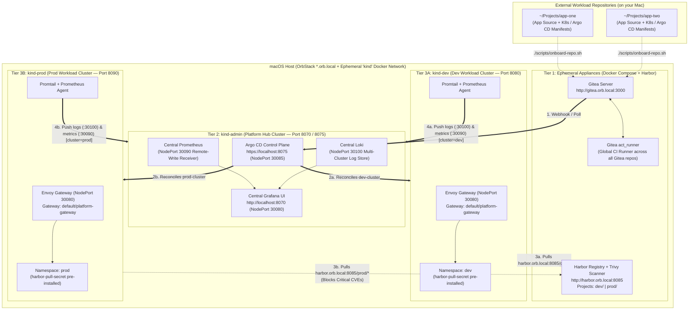

# Ephemeral Local Kubernetes Platform Engineering Lab

A **100% local, ephemeral, app-agnostic Kubernetes Platform Engineering Lab** for macOS (optimized for **OrbStack** and **Kind**).

This repository provisions **pure platform infrastructure** ("your local cloud provider"). Your applications and GitOps workloads live in **separate repositories** on your Mac and can be onboarded into this platform at any time.

---

## Core Philosophy: Decoupled Platform vs. Workloads

- **100% Local Runtime:** Once bootstrapped, **zero traffic leaves your Mac**. Git hosting (**Gitea**), CI pipelines (**Gitea `act_runner`**), OCI Registry & CVE scanning (**Harbor + Trivy**), GitOps reconciliation (**Argo CD**), Edge Ingress (**Envoy Gateway**), and Observability (**Grafana + Prometheus + Loki**) all run locally on the shared `kind` Docker network.
- **App-Agnostic Infrastructure (`local-lab`):** This repository only manages the platform lifecycle (`bootstrap-{common,orbstack,linux}.sh`, `onboard-repo.sh`, `nuke-lab.sh`). It contains zero hardcoded application code or workload manifests.
- **Multi-Repo Ready:** You can develop one or many application repositories anywhere on your Mac (e.g. `~/Projects/my-app`), onboard them into local Gitea with a single command, push container images to Harbor, and deploy them across `kind-dev` and `kind-prod` via Argo CD.

---

## Architecture Overview



---

## 1. Prerequisites

Ensure **OrbStack** (or Docker Desktop) is running on macOS and install the required CLI tools:

```bash
brew install kind kubectl kustomize helm argocd jq go skopeo
```

---

## 2. Quick Start: Boot the Platform

Run the platform-specific bootstrap script to provision all 3 tiers:

```bash
# macOS (OrbStack):
./scripts/bootstrap-orbstack.sh

# Native Linux:
./scripts/bootstrap-linux.sh
```

### What `bootstrap-{orbstack,linux}.sh` + `bootstrap-common.sh` Set Up for You:
1. **Gitea (`http://gitea.orb.local:3000`)**:
   - Admin credentials: `platform` / `password123`
   - Global `gitea-runner` (`act_runner`) registered and ready to run `.gitea/workflows/*.yml` for any repository pushed to Gitea.
2. **Harbor + Trivy (`http://harbor.orb.local:8085`)**:
   - Admin credentials: `admin` / `Harbor12345`
   - `dev` project: Auto-scans images on push with Trivy.
   - `prod` project: Auto-scans images and **blocks pulls if Critical CVEs are present**.
3. **3 Kind Clusters (`kind-admin`, `kind-dev`, `kind-prod`)**:
   - Containerd pre-configured to mirror `harbor.orb.local:8085` over the internal `kind` Docker network.
   - `kind-dev` and `kind-prod` pre-registered in Argo CD as `dev-cluster` and `prod-cluster`.
   - `dev` and `prod` namespaces pre-created on their respective clusters with `harbor-pull-secret` installed.
   - **Envoy Gateway** (`GatewayClass: eg`, `Gateway: default/platform-gateway`) listening on host port `8080` (`kind-dev`) and `8090` (`kind-prod`).
   - **Central Grafana (`http://localhost:8070`)**, Prometheus, and Loki running on `kind-admin`, receiving metrics (`cluster=dev|prod`) and logs from agents on both workload clusters.

---

## 3. Onboarding an Application Repository

You can keep your application code in any separate directory on your Mac (e.g., `~/Projects/my-new-app`).

To connect a local Git repository to your running platform lab:

```bash
./scripts/onboard-repo.sh ~/Projects/my-new-app
```

### What `onboard-repo.sh` Does:
1. Creates the repository in local Gitea (`http://gitea.orb.local:3000/platform/<repo-name>.git`).
2. Preserves your existing GitHub `origin` remote by renaming it to `seed` (with `push` set to `DISABLED` so local chaos experiments never accidentally push to GitHub), and sets `origin` to local Gitea.
3. Creates/updates `dev` and `prod` branches and pushes them to Gitea.
4. Configures branch protection on `prod` in Gitea (disables direct push; requires a Pull Request and passing `test` status check).
5. If your repository has an `argocd/` directory, automatically applies those Argo CD manifests (`Application` or `ApplicationSet`) to `kind-admin`.

---

## 4. Platform Contracts for Workload Repositories

When building a new application repo to run on this platform, use these pre-provisioned platform primitives:

| Platform Resource | Value / Reference |
| :--- | :--- |
| **Gitea Internal Repo URL (for Argo CD `repoURL`)** | `http://gitea:3000/platform/<repo-name>.git` |
| **Argo CD Target Cluster Names** | `dev-cluster` (`kind-dev`) and `prod-cluster` (`kind-prod`) |
| **Harbor Registry Endpoints** | `harbor.orb.local:8085/dev/<image>:<tag>` and `harbor.orb.local:8085/prod/<image>:<tag>` |
| **Pre-installed Image Pull Secret** | `harbor-pull-secret` (in `dev` namespace on `kind-dev` and `prod` namespace on `kind-prod`) |
| **Gateway API Parent Gateway** | `name: platform-gateway`, `namespace: default` (attach via `HTTPRoute`) |
| **Workload Edge Ports on Mac** | `http://<your-dev-host>:8080` (`kind-dev`) and `http://<your-prod-host>:8090` (`kind-prod`) |

---

## 5. Running on Linux (Beelink SER9 or Local Lima Ubuntu 26.04 LTS VM)

OrbStack is a macOS-only application (it runs a lightweight Linux VM and provides automatic `*.orb.local` DNS resolution on macOS). You can also run this entire platform lab on a dedicated Ubuntu Server—either on physical hardware (such as an AMD Ryzen Beelink SER9) or inside a local headless Ubuntu 26.04 LTS VM on Apple Silicon via **Lima** ([`beelink.yaml`](beelink.yaml)).

### Option 1: Local Headless Ubuntu 26.04 LTS Server VM via Lima (`beelink.yaml`)

If your physical Linux box is unavailable, [`beelink.yaml`](beelink.yaml) provisions an isolated headless **Ubuntu 26.04.1 LTS** VM on Apple Silicon (`Virtualization.framework`) with **8 vCPUs**, **32 GiB RAM**, **100 GiB disk**, **Apple Rosetta `x86_64` translation** enabled for `linux/amd64` containers, and dual NICs (`eth0` for outbound NAT internet + `vz0` pinned to `192.168.64.50` for Wi-Fi-independent Mac-to-VM networking with zero OrbStack port conflicts):

```bash
# 1. Install Lima (one-time) and boot the headless Ubuntu 26.04 LTS VM:
brew install lima
limactl start --name=beelink ./beelink.yaml --tty=false

# 2. Provision the VM with Ansible (installs Docker, Kind, Kubectl, Helm, Argo CD, sysctl limits):
uv run --with ansible-core ansible-playbook -i ansible/inventory.ini -l lima ansible/playbook.yml

# 3. Drop into the Ubuntu Server TUI and boot the 3-cluster platform:
limactl shell beelink
cd ~/Projects/local-lab && ./scripts/bootstrap-linux.sh
```

Once running inside the `beelink` VM, all UIs are reachable from your Mac via its dedicated host-only IP **`192.168.64.50`** (e.g. `http://192.168.64.50:3000` for Gitea, `http://192.168.64.50:8070` for Grafana, `https://192.168.64.50:8075` for Argo CD).

### Option 2: Physical Ubuntu Server (e.g. Beelink SER9 / Native `x86_64`)

#### Step A: Prepare a Fresh Ubuntu Host with Ansible (One-Time Setup)

An idempotent Ansible playbook ([`ansible/playbook.yml`](ansible/playbook.yml)) is included to install all prerequisites on Ubuntu 22.04 / 24.04 / 26.04 (`docker`, `kind`, `kubectl`, `kustomize`, `helm`, `argocd`, `jq`, `skopeo`, `git`, `curl`, `go`), tune kernel `inotify` limits for running 3 Kind clusters concurrently, and pre-configure `/etc/hosts` and `/etc/docker/daemon.json`:

```bash
# Option A: Run from your Mac against the remote Ubuntu server over SSH (via uv — no global Ansible install needed)
# Either pass user@ip inline (note the trailing comma):
uv run --with ansible-core ansible-playbook -i "luis@<UBUNTU_IP>," ansible/playbook.yml --ask-become-pass

# Or set the host under [ubuntu_lab] in ansible/inventory.ini and run:
uv run --with ansible-core ansible-playbook -i ansible/inventory.ini -l ubuntu_lab ansible/playbook.yml --ask-become-pass

# Option B: Run directly on the Ubuntu machine itself
uv run --with ansible-core ansible-playbook -i ansible/inventory.ini -l local ansible/playbook.yml --ask-become-pass
newgrp docker   # (or log out and back in so your shell picks up the 'docker' group)
```

#### Step B: Boot the Platform on Linux

Simply run [`./scripts/bootstrap-linux.sh`](scripts/bootstrap-linux.sh), which automatically verifies (and applies if missing) the 3 Linux host adjustments before invoking [`scripts/bootstrap-common.sh`](scripts/bootstrap-common.sh):

1. **Map `gitea.orb.local` and `harbor.orb.local` in `/etc/hosts` (Host DNS):**
   Inside the `kind` Docker network, Docker's embedded DNS already resolves `gitea`, `harbor.orb.local`, and `nginx` automatically via container aliases. `bootstrap-linux.sh` ensures `/etc/hosts` resolves them to `127.0.0.1` on the Linux host so your browser and CLI commands (`curl`, `docker login`, `git push`) work identically.
2. **Configure Docker `insecure-registries` in `/etc/docker/daemon.json`:**
   `bootstrap-linux.sh` merges `"harbor.orb.local:8085"` into `/etc/docker/daemon.json` via `jq` and restarts `docker` if needed.
3. **Cross-Platform `sed` Handling in [`scripts/bootstrap-common.sh`](scripts/bootstrap-common.sh):**
   `bootstrap-common.sh` automatically detects `uname -s` (`Darwin` vs. `Linux`) to switch between macOS BSD `sed -i ''` and Linux GNU `sed -i`.

---

## 6. Teardown / Total Nuke

When you are finished experimenting and want to reclaim all CPU/RAM/disk space:

```bash
./scripts/nuke-lab.sh
```

This destroys `kind-admin`, `kind-dev`, `kind-prod`, Gitea, the Actions runner, Harbor, the `kind` Docker network, and `.lab-runtime/`.
