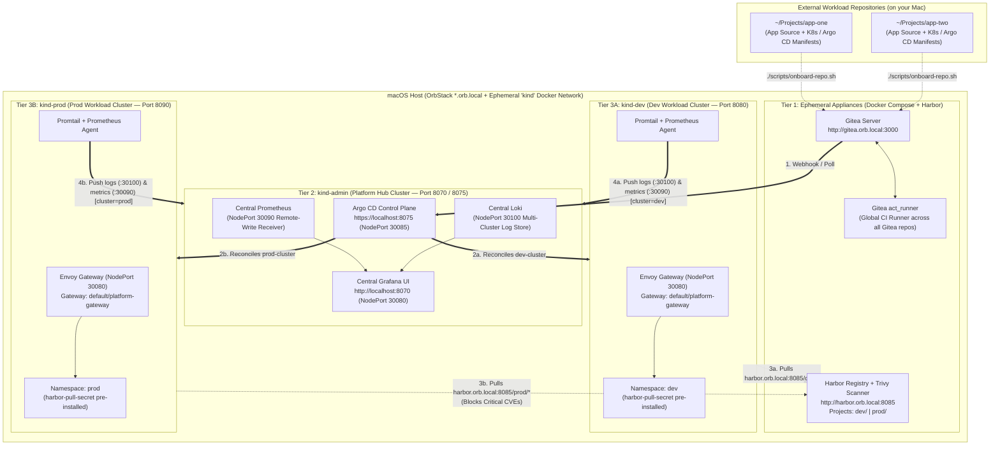

# Ephemeral Local Kubernetes Platform Engineering Lab

A **100% local, ephemeral, app-agnostic Kubernetes Platform Engineering Lab** for macOS (optimized for **OrbStack** and **Kind**).

This repository provisions **pure platform infrastructure** ("your local cloud provider"). Your applications and GitOps workloads live in **separate repositories** on your Mac and can be onboarded into this platform at any time.

---

## Core Philosophy: Decoupled Platform vs. Workloads

- **100% Local Runtime:** Once bootstrapped, **zero traffic leaves your Mac**. Git hosting (**Gitea**), CI pipelines (**Gitea `act_runner`**), OCI Registry & CVE scanning (**Harbor + Trivy**), GitOps reconciliation (**Argo CD**), Edge Ingress (**Envoy Gateway**), and Observability (**Grafana + Prometheus + Loki**) all run locally on the shared `kind` Docker network.
- **App-Agnostic Infrastructure (`local-lab`):** This repository only manages the platform lifecycle (`bootstrap-lab.sh`, `onboard-repo.sh`, `nuke-lab.sh`). It contains zero hardcoded application code or workload manifests.
- **Multi-Repo Ready:** You can develop one or many application repositories anywhere on your Mac (e.g. `~/Projects/my-app`), onboard them into local Gitea with a single command, push container images to Harbor, and deploy them across `kind-dev` and `kind-prod` via Argo CD.

---

## Architecture Overview



---

## 1. Prerequisites

Ensure **OrbStack** (or Docker Desktop) is running on macOS and install the required CLI tools:

```bash
brew install kind kubectl kustomize helm argocd jq go skopeo
```

---

## 2. Quick Start: Boot the Platform

Run the bootstrap script to provision all 3 tiers:

```bash
./scripts/bootstrap-lab.sh
```

### What `bootstrap-lab.sh` Sets Up for You:
1. **Gitea (`http://gitea.orb.local:3000`)**:
   - Admin credentials: `platform` / `password123`
   - Global `gitea-runner` (`act_runner`) registered and ready to run `.gitea/workflows/*.yml` for any repository pushed to Gitea.
2. **Harbor + Trivy (`http://harbor.orb.local:8085`)**:
   - Admin credentials: `admin` / `Harbor12345`
   - `dev` project: Auto-scans images on push with Trivy.
   - `prod` project: Auto-scans images and **blocks pulls if Critical CVEs are present**.
3. **3 Kind Clusters (`kind-admin`, `kind-dev`, `kind-prod`)**:
   - Containerd pre-configured to mirror `harbor.orb.local:8085` over the internal `kind` Docker network.
   - `kind-dev` and `kind-prod` pre-registered in Argo CD as `dev-cluster` and `prod-cluster`.
   - `dev` and `prod` namespaces pre-created on their respective clusters with `harbor-pull-secret` installed.
   - **Envoy Gateway** (`GatewayClass: eg`, `Gateway: default/platform-gateway`) listening on host port `8080` (`kind-dev`) and `8090` (`kind-prod`).
   - **Central Grafana (`http://localhost:8070`)**, Prometheus, and Loki running on `kind-admin`, receiving metrics (`cluster=dev|prod`) and logs from agents on both workload clusters.

---

## 3. Onboarding an Application Repository

You can keep your application code in any separate directory on your Mac (e.g., `~/Projects/my-new-app`).

To connect a local Git repository to your running platform lab:

```bash
./scripts/onboard-repo.sh ~/Projects/my-new-app
```

### What `onboard-repo.sh` Does:
1. Creates the repository in local Gitea (`http://gitea.orb.local:3000/platform/<repo-name>.git`).
2. Preserves your existing GitHub `origin` remote by renaming it to `seed` (with `push` set to `DISABLED` so local chaos experiments never accidentally push to GitHub), and sets `origin` to local Gitea.
3. Creates/updates `dev` and `prod` branches and pushes them to Gitea.
4. Configures branch protection on `prod` in Gitea (disables direct push; requires a Pull Request and passing `test` status check).
5. If your repository has an `argocd/` directory, automatically applies those Argo CD manifests (`Application` or `ApplicationSet`) to `kind-admin`.

---

## 4. Platform Contracts for Workload Repositories

When building a new application repo to run on this platform, use these pre-provisioned platform primitives:

| Platform Resource | Value / Reference |
| :--- | :--- |
| **Gitea Internal Repo URL (for Argo CD `repoURL`)** | `http://gitea:3000/platform/<repo-name>.git` |
| **Argo CD Target Cluster Names** | `dev-cluster` (`kind-dev`) and `prod-cluster` (`kind-prod`) |
| **Harbor Registry Endpoints** | `harbor.orb.local:8085/dev/<image>:<tag>` and `harbor.orb.local:8085/prod/<image>:<tag>` |
| **Pre-installed Image Pull Secret** | `harbor-pull-secret` (in `dev` namespace on `kind-dev` and `prod` namespace on `kind-prod`) |
| **Gateway API Parent Gateway** | `name: platform-gateway`, `namespace: default` (attach via `HTTPRoute`) |
| **Workload Edge Ports on Mac** | `http://<your-dev-host>:8080` (`kind-dev`) and `http://<your-prod-host>:8090` (`kind-prod`) |

---

## 5. Teardown / Total Nuke

When you are finished experimenting and want to reclaim all CPU/RAM/disk space:

```bash
./scripts/nuke-lab.sh
```

This destroys `kind-admin`, `kind-dev`, `kind-prod`, Gitea, the Actions runner, Harbor, the `kind` Docker network, and `.lab-runtime/`.
