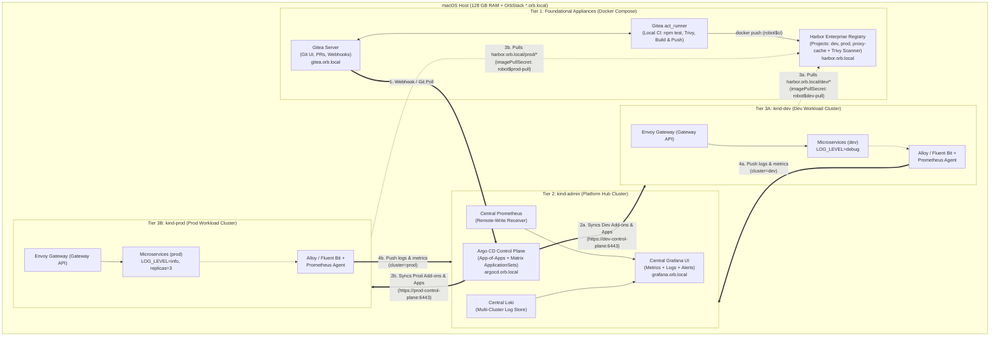

# Local-to-Production Kubernetes Platform Engineering: Analysis, Trade-offs & Target Architecture

> **Context:** This document captures our architectural review of `kubernetes-terraform-lab`, its conceptual comparison against [kubernetes_gitops_local_platform_engineering_lab.md](./kubernetes_gitops_local_platform_engineering_lab.md), and the resulting design for a **100% local, enterprise-grade Multi-Cluster Platform Engineering Lab** running on macOS (Apple Silicon / 128 GB RAM) with **OrbStack**.
>
> **Core Goal:** Bridge the gap between a local tutorial lab and the real-world architectures, tools, and operational workflows required to administer a production Kubernetes environment at a company.

---

## Table of Contents

1. [Part 1: Breakdown of `kubernetes-terraform-lab`](#part-1-breakdown-of-kubernetes-terraform-lab)
2. [Part 2: Conceptual Comparison — `kubernetes-terraform-lab` vs. Reference Guide](#part-2-conceptual-comparison--kubernetes-terraform-lab-vs-reference-guide)
3. [Part 3: GitOps & CI/CD — What Runs Where (and Why)](#part-3-gitops--cicd--what-runs-where-and-why)
4. [Part 4: Production Tooling Decisions (Argo CD, Gitea, Harbor vs. Artifactory, Observability)](#part-4-production-tooling-decisions-argo-cd-gitea-harbor-vs-artifactory-observability)
5. [Part 5: The Target Multi-Cluster "Hub-and-Spoke" Architecture](#part-5-the-target-multi-cluster-hub-and-spoke-architecture)
7. [Part 7: Additional Architectural Principles Established](#part-7-additional-architectural-principles-established)
8. [Part 8: Phase 2 Evolution — Decoupling Platform Infrastructure from Workload Repositories (2026-11-04)](#part-8-phase-2-evolution--decoupling-platform-infrastructure-from-workload-repositories-2026-11-04)

---

## Part 1: Breakdown of `kubernetes-terraform-lab`

Despite the historical repository name, **Terraform is retired** in `kubernetes-terraform-lab` (`main.tf` and `outputs.tf` are empty; `modules/web-app` is retained only for reference). All workloads are deployed via **Argo CD (GitOps)** and **Kustomize** onto a local `kind` cluster (`kind-terraform-lab`).

### 1.1 Workloads & Microservices Topology
1. **`temp-converter` (`app/`):**
   - Express.js web app and REST API (`/api/convert?from=c&value=100`, `/healthz`).
   - Deployed via a standalone Argo CD `Application` (`argocd/application.yaml`) from `k8s/temp-converter` into namespace `argocd-lab`, tracking the `master` branch.
2. **Microservices Demo (`orders-api`, `payments-api`, `inventory-api`):**
   - Zero-dependency Node.js HTTP services located in `k8s/base/<service>/src/server.js`.
   - **East–West Call Flow:** `POST /orders` on `orders-api` (`{"productId": "A1", "quantity": 2, "amount": 50}`) calls `http://inventory-api/reserve` (`POST`), then `http://payments-api/charge` (`POST`), returning `201 Created` with both upstream payloads.
   - **Built-in Failure Modes (for testing resilience):**
     - `productId: "OUT-OF-STOCK"` → `409 Conflict`
     - `amount > 1000` → `402 Payment Required`
     - Invalid payload → `400 Bad Request`
     - Unreachable/failing upstream dependency or 3s timeout → `502 Bad Gateway`

### 1.2 Kustomize Base & Overlay Design
```text
k8s/
├── base/<service>/             # Shared Dockerfile, package.json, src/, deployment.yaml, service.yaml, kustomization.yaml
├── overlays/<env>/<service>/   # Per-env namespace, replicas, pinned image newTag, strategic-merge LOG_LEVEL patch
└── temp-converter/             # Single-env Kustomize app
```
- **Clean Base Hygiene:** Base manifests carry **no `namespace`** and **no `images:` tag block**.
- **Environment Overlays (`dev` vs. `staging`):**
  - `dev` sets `namespace: dev`, `LOG_LEVEL=debug`, and per-service replica counts and image tags (`newTag: "x.y.z"`).
  - `staging` sets `namespace: staging`, `LOG_LEVEL=info`, and its own replica counts and image tags.
- **Namespace Isolation for Service Discovery:** Because `orders-api` calls `http://inventory-api` and `http://payments-api` using unqualified service names, Kubernetes DNS resolves them within the pod's own namespace—guaranteeing `dev` never talks to `staging`.

### 1.3 Argo CD Matrix `ApplicationSet` & Branch-per-Environment GitOps
- `argocd/microservices-appset.yaml` uses a **Matrix Generator** crossing:
  - `env` / `branch`: `[{env: dev, branch: dev}, {env: staging, branch: staging}]`
  - `service`: `[orders, payments, inventory]`
- This generates **6 Argo CD Applications** (`{orders,payments,inventory}-api-{dev,staging}`).
- Every Application has `automated: { prune: true, selfHeal: true }` and `CreateNamespace=true`.
- **Branch Isolation:** Each environment tracks the Git branch of the same name (`dev` tracks `dev`, `staging` tracks `staging`). Pushing to `dev` only affects the `dev` namespace.

### 1.4 Release, Promotion, and Testing Automation
- **Local Build & Node Injection (`scripts/build-and-load.sh`):**
  - Because `kind` has no container registry in this project, the script builds the Docker image locally, runs `kind load docker-image <image>:<tag> --name terraform-lab` to stream it directly into the Kind node's `containerd`, and updates `newTag` in the target overlay's `kustomization.yaml`.
- **Promotion (`scripts/set-image.sh`):**
  - Verifies via `docker exec terraform-lab-control-plane crictl images` that the target image tag already exists in the cluster node, then updates `kustomization.yaml` (e.g., `scripts/set-image.sh orders staging --from dev` after `git merge dev`).
- **Automated Test Suite (`npm test`, Node >= 22 built-in runner):**
  - **Service & E2E Tests (`tests/payments.test.js`, `tests/inventory.test.js`, `tests/orders.test.js`, `tests/e2e.test.js`):** Spins up real service processes on ephemeral ports, testing business rules, error pass-through, timeouts, and outage recovery.
  - **Manifest & Policy-as-Code Tests (`tests/manifests.test.js`):** Renders every Kustomize overlay with `kubectl kustomize` and asserts structural invariants (1 Deployment + 1 Service, no hardcoded `Namespace` resource, pinned quoted `x.y.z` tag, `LOG_LEVEL` match, port/probe/selector alignment, resource requests/limits, `imagePullPolicy: IfNotPresent`, and exact parity between `ApplicationSet` generators and `k8s/overlays/*` folders).

> **Note on Fork Branch State:** In the local clone of `kubernetes-terraform-lab`, `INSTALLATION.md` (the 10-step bootstrap guide from scratch) and the `README.md` link to it were committed on `dev` (`4cb0f9d`), while the working tree is checked out on `master` (`fbf2bc4`).

---

## Part 2: Conceptual Comparison — `kubernetes-terraform-lab` vs. Reference Guide

Both `kubernetes-terraform-lab` and [kubernetes_gitops_local_platform_engineering_lab.md](./kubernetes_gitops_local_platform_engineering_lab.md) share the same core philosophy: **local Kubernetes on Kind + Kustomize environment overlays + Argo CD automated reconciliation (`prune` + `selfHeal`).**

However, they focus on opposite halves of the platform engineering stack:

| Fundamental Dimension | Reference Guide (`kubernetes_gitops_local_platform_engineering_lab.md`) | `kubernetes-terraform-lab` (Current Project) |
| :--- | :--- | :--- |
| **Primary Pedagogical Focus** | **Cluster Infrastructure & Edge Networking:** Multi-node Kind cluster, local OCI registry with `containerd` mirrors, and North–South ingress via Kubernetes **Gateway API (Envoy Gateway)**. | **SDLC Governance, Multi-Service Promotion & GitOps Hygiene:** East–West microservice communication, multi-env matrix `ApplicationSet`, immutable tag promotion, and automated CI/manifest gates. |
| **Traffic Direction** | **North–South (External Client → Edge Gateway → Service):** Host port `80`/`443` mapped to Envoy Gateway routing `HTTPRoute` hostnames (`calc.local`, `calc.prod.local`). | **East–West (Service → Service → Service):** Internal `ClusterIP` services communicating via Kubernetes DNS (`orders` → `inventory` → `payments`); developer access via `kubectl port-forward`. |
| **Image Supply Chain** | **Local Registry Container (`registry:2` on `localhost:5001`):** Patches Kind `containerd` config mirrors + KEP-1755 `local-registry-hosting` ConfigMap. Uses standard `docker push` / Kubelet pull. | **Direct Node Side-Loading (`kind load docker-image`):** No registry. Injects image tarballs straight into the node's `containerd` cache with `imagePullPolicy: IfNotPresent`. |
| **GitOps Environment Model** | **Single-Branch (`targetRevision: HEAD`) + Directory Split:** Separates `dev` and `prod` by directory path (`gitops/envs/dev` vs `prod`), using individual `Application` manifests. | **Branch-per-Environment (`dev` / `staging`) + Matrix `ApplicationSet`:** Double isolation via both Git branch (`targetRevision: "{{branch}}"`) and overlay folder (`k8s/overlays/{{env}}/{{service}}`). |
| **Image Tag Management** | Suggests editing `image:` directly in `gitops/base/deployment.yaml` (which mutates all overlays simultaneously unless patched). | Base has no tag; each overlay pins `images.newTag: "x.y.z"`. Promotion moves a tested tag from `dev` to `staging` via CLI script. |
| **Day-1 vs. Day-2 Automation** | **Automated Day-1** (`setup-lab.sh` provisions registry, multi-node cluster, Envoy Gateway, and Argo CD in one shot); **Manual Day-2** (hand-editing YAML, no automated tests). | **Documented Manual Day-1** (`INSTALLATION.md`); **Automated Day-2** (`build-and-load.sh`, `set-image.sh`, E2E tests, Kustomize policy tests, and CI branch protection gates). |

---

## Part 3: GitOps & CI/CD — What Runs Where (and Why)

### 3.1 Clarifying the Role of GitHub Actions in `kubernetes-terraform-lab`
A common misconception is that GitHub Actions performs the deployment in `kubernetes-terraform-lab`. **It does not:**
- **GitHub Actions (`.github/workflows/test.yml`) is strictly a read-only CI test runner (`permissions: contents: read`).** It runs `npm test` on PRs and pushes to `master`, `dev`, and `staging`. It never builds Docker images, never pushes to a registry, never commits to Git, and has zero network access or credentials to your local `kind` cluster.
- **All image building (`scripts/build-and-load.sh`) and manifest tag updates (`scripts/set-image.sh`) happen 100% locally on your Mac.**
- **Argo CD (running locally inside `kind`) performs the CD** by polling `https://github.com/...` using the `repo-k8s-lab` read-only token secret.
- GitHub Actions serves solely as a **branch protection gatekeeper**: because Argo CD auto-syncs `dev` and `staging` from GitHub, requiring the `test` check to pass on PRs prevents broken manifests or failing code from ever reaching a branch that Argo CD watches.

### 3.2 The "Local Git" Catch in the Reference Guide
In [kubernetes_gitops_local_platform_engineering_lab.md](./kubernetes_gitops_local_platform_engineering_lab.md) (Step 4), the guide runs `git init` in a local directory on your Mac (`gitops/`).
- **The Catch:** Argo CD's `repo-server` pod runs inside a Kind container and **cannot read a bare folder path on your macOS filesystem**. It requires a network-reachable Git server (`http://`, `https://`, or `ssh://`).
- That is why Step 5 of the guide falls back to `repoURL: 'https://github.com/your-org/platform-lab.git'` or notes that offline setups require a local **Gitea** instance.

---

## Part 4: Production Tooling Decisions (Argo CD, Gitea, Harbor vs. Artifactory, Observability)

To make a local lab directly transferable to **administering a real company's production platform**, we evaluated each layer against industry standards:

### 4.1 CI vs. CD & Why Argo CD is the Production Standard
In production Kubernetes, **CI** (Continuous Integration) and **CD** (Continuous Delivery) are separated:
- **CI (GitHub Actions / GitLab CI / Gitea Actions):** Tests code, builds images, runs vulnerability scans, pushes images to the registry, and updates the image tag in the GitOps repo. **CI never holds `cluster-admin` credentials to production.**
- **CD (Argo CD):** Lives inside the Kubernetes platform, pulls desired state from Git, reconciles the cluster, and self-heals drift.

**Market Reality:**
1. **Argo CD (CNCF Graduated — ~65%+ market share):** The undisputed industry standard. Provides a rich UI, SSO/RBAC, `AppProject` multi-tenancy, `ApplicationSet` automation, multi-cluster hub-and-spoke support, and pairs with **Argo Rollouts** (Canary / Blue-Green progressive delivery).
2. **Flux CD (CNCF Graduated — ~25–30% market share):** The main alternative; CLI/CRD-driven with no built-in UI by default.
3. **Production Argo CD Skills to Practice:**
   - Multi-cluster `ApplicationSet`s.
   - The **App-of-Apps** pattern (using Argo CD to deploy platform add-ons like Envoy Gateway, Cert-Manager, and Prometheus/Loki, not just app workloads).
   - **Secrets Management** in GitOps (**External Secrets Operator (ESO)** or **Bitnami Sealed Secrets**, so raw secrets never touch Git).

### 4.2 Self-Hosted Git & Local CI: **Gitea + `act_runner`**
- **Resource Footprint:** Written in Go and backed by SQLite, Gitea uses **~80–120 MB RAM** idle (and `act_runner` uses ~30 MB idle).
- **100% Local & GitHub-Compatible:**
  - Replaces GitHub.com as the Git remote so the entire lab works offline on the local Docker network.
  - **Gitea Actions (`act_runner`)** executes the exact same `.github/workflows/test.yml` workflow syntax locally on your Mac whenever you push or open a PR.
  - **Instant Webhooks:** Because Gitea and Argo CD share the local network, Gitea can fire push webhooks directly to Argo CD—triggering deployments in **< 1 second** on `git push` instead of waiting for Argo CD's 3-minute polling interval.

### 4.3 Container Registry: Why **Harbor** Beats Both `registry:2` and **JFrog Artifactory** for the Lab

#### Why `registry:2` is Too Basic for Production Training
While `registry:2` speaks the standard OCI Distribution API, it has **no authentication, no UI, no vulnerability scanning, and no access control**. In real companies, Kubernetes must authenticate using `imagePullSecrets` (or cloud workload identity), and images must pass CVE checks.

#### Harbor vs. JFrog Artifactory (Enterprise Comparison)
Both are major enterprise tools, but they target different scopes and have very different licensing models:

| Feature / Dimension | **Harbor** *(CNCF Graduated — Chosen for Lab)* | **JFrog Artifactory** *(Commercial Universal Manager)* |
| :--- | :--- | :--- |
| **Licensing & Free Tier** | **100% Open Source (Apache 2.0).** Every enterprise feature is free and unlocked out of the box. | **Proprietary for Docker/K8s.** The free `artifactory-oss` image **strips out Docker and Helm support**. Free *JFrog Container Registry (JCR)* requires license activation and omits vulnerability scanning (*JFrog Xray* is paid). |
| **Artifact Scope** | **Cloud-Native OCI Specialist:** Container images, Helm charts, OCI artifacts, Cosign signatures, SBOMs. | **Universal Binary Repository:** Hosts Maven/Gradle `.jar`, `npm`, `pip`/PyPI, NuGet, Go, `.deb`/`.rpm`, Terraform, Helm, and Docker. |
| **Vulnerability Scanning** | **Built-in & Free via Trivy.** Can automatically block Kubernetes from pulling images with Critical/High CVEs. | Requires paid **JFrog Xray** license + separate heavy container stack. |
| **Environment Isolation & Promotion** | **Project-based (`/dev/...`, `/prod/...`)** + Replication rules + Immutable tag rules. | **Local + Remote + Virtual repos** + API promotion (`docker-dev-local` → `docker-prod-local`). |
| **RAM Footprint** | **~1.5 – 2.5 GB RAM** (~9 lightweight containers). | **~4 – 8+ GB RAM** (Heavy JVM monolith + router + Postgres; +4 GB for Xray). |

> **Note on OrbStack vs. JFrog Licensing:** Using **OrbStack** replaces *Docker Desktop* (avoiding Docker Inc.'s commercial desktop license and giving macOS fast container networking + automatic `*.orb.local` domains). However, Artifactory's restriction is hardcoded inside JFrog's own application software. With **128 GB RAM on macOS**, choosing **Harbor** gives us 100% of enterprise registry capabilities (Projects, Robot Accounts, `imagePullSecrets`, Trivy CVE policy gates, Docker Hub Proxy Cache, and Tag Immutability) with zero license walls.

> **Two Artifactory Concepts Worth Knowing for Enterprise Interviews:**
> 1. **Local + Remote + Virtual Repositories:** Enterprises block direct internet access to Docker Hub / npm / PyPI. They use **Local repos** for internal builds, **Remote repos** as caching proxies for upstream public registries, and **Virtual repos** to expose both behind a single URL. *(In Harbor, you achieve this same pattern using **Proxy Cache Projects** + **Internal Projects**.)*
> 2. **Repository-Level Promotion (`dev-local` → `prod-local`):** The `prod` cluster's credentials are scoped so it can *only* pull from the `prod` repository/project. Promoting a release means copying/re-tagging the verified image digest from the `dev` project into the `prod` project.

### 4.4 Observability: **Grafana LGTM Stack** over Legacy **ELK (Logstash)**
In modern Kubernetes platform engineering, the **CNCF / Grafana LGTM Stack + OpenTelemetry** has largely replaced the legacy **ELK Stack** (Elasticsearch + Logstash + Kibana):
- **Logs — Grafana Loki + Grafana Alloy (or Fluent Bit) instead of Elasticsearch + Logstash:**
  - Logstash (JVM) and Elasticsearch (which full-text indexes every word of every log line) are massive resource hogs.
  - **Alloy / Fluent Bit** runs as a lightweight DaemonSet on each cluster, tails `/var/log/containers/*.log`, attaches Kubernetes labels (`cluster`, `namespace`, `pod`, `app`), and ships them to **Loki**, which indexes only the labels and compresses the log streams.
- **Metrics — Prometheus (`kube-prometheus-stack`):**
  - Scrapes `kube-state-metrics`, `node-exporter`, and application metrics across all clusters.
- **Traces — Grafana Tempo (OpenTelemetry):**
  - Captures distributed traces across `orders-api` → `inventory-api` → `payments-api`.
- **Single Pane of Glass — Grafana:**
  - Unifies Metrics (Prometheus), Logs (Loki), and Traces (Tempo) in one UI, allowing operators to filter by `cluster="dev"` vs `cluster="prod"`.

---

## Part 5: The Target Multi-Cluster "Hub-and-Spoke" Architecture

### 5.1 Why Split `docker compose` (Appliances) from `kind` (Kubernetes Clusters)?

A critical architectural insight from our session is **where each tool should live**:

1. **Tier 1: External Foundational Appliances in `docker compose` (`Gitea` + `act_runner` + `Harbor`)**
   - **No Chicken-and-Egg Problem:** Your Git server and Container Registry start in seconds before any Kubernetes cluster even exists.
   - **No `containerd` NodePort Gymnastics:** Because `containerd` pulls images at the Kind *node* level (not pod level), running Harbor on the shared Docker network (`harbor.orb.local`) makes it natively reachable by every Kind node's `containerd` daemon and your Mac's CLI.
   - **Survives Cluster Wipes:** You can run `kind delete cluster --name dev` (or wipe all 3 Kind clusters) without losing a single Git commit, pull request, pipeline run, or container image in Harbor.

2. **Tier 2: `kind-admin` — The Platform Control Plane ("Hub") Cluster**
   - **Why `Argo CD` Must Live in Kubernetes:** Unlike Gitea or Harbor, Argo CD has no SQL database—it stores `Application`s, `ApplicationSet`s, `AppProject`s, and cluster credentials as **Kubernetes CRDs and Secrets** in `etcd`.
   - **Why Central Observability (`Grafana`, `Prometheus`, `Loki`, `Tempo`) Belongs in `kind-admin`:**
     - If `kind-prod` suffers an outage, your monitoring, alerting, and log history stay up and healthy inside `kind-admin`.
     - Provides a single Grafana instance querying metrics and logs aggregated from all clusters.

3. **Tier 3: `kind-dev` & `kind-prod` — Isolated Workload ("Spoke") Clusters**
   - Clean, lightweight workload clusters with **zero Argo CD pods** and **zero heavy log/metric databases**.
   - Each runs **Envoy Gateway (Gateway API)** for North–South traffic, lightweight **Observability Agents** (Alloy/Fluent Bit + Prometheus Agent) pushing telemetry back to `kind-admin`, and the environment's **Application Workloads**.

### 5.2 Complete Architecture Diagram



---

### 5.3 Component Inventory & Resource Allocation

On a 128 GB RAM Mac with OrbStack, this entire enterprise topology consumes roughly **6–8 GB of RAM total** (~5% of system memory):

| Tier | Component | Role in the Platform | Approx. RAM |
| :--- | :--- | :--- | :--- |
| **Tier 1 (`docker compose`)** | **Gitea** (`gitea/gitea`) | Self-hosted Git server, PRs, branch protection, webhooks to Argo CD. | ~120 MB |
| **Tier 1 (`docker compose`)** | **Gitea Actions Runner** (`gitea/act_runner`) | Executes `.github/workflows/test.yml` locally on push/PR. | ~50 MB (idle) |
| **Tier 1 (`docker compose`)** | **Harbor** (`goharbor/harbor`) | OCI Registry (`dev`, `prod`, `proxy-cache` projects), Trivy CVE scanner, Robot accounts. | ~2.0 GB |
| **Tier 2 (`kind-admin`)** | **Argo CD** | Central GitOps controller managing `kind-admin`, `kind-dev`, and `kind-prod`. | ~800 MB |
| **Tier 2 (`kind-admin`)** | **Grafana + Prometheus + Loki** | Central observability hub receiving metrics & logs from all clusters. | ~1.5 GB |
| **Tier 3A (`kind-dev`)** | **Envoy Gateway + Telemetry Agents + Dev Apps** | Isolated development Kubernetes cluster (`cluster=dev`). | ~1.0 GB |
| **Tier 3B (`kind-prod`)** | **Envoy Gateway + Telemetry Agents + Prod Apps** | Isolated production Kubernetes cluster (`cluster=prod`). | ~1.0 GB |

---

## Part 6: End-to-End Day-2 Workflow in the Target Platform

Once built, your day-to-day workflow on your Mac mirrors how a senior platform engineer operates a production environment:

1. **Code & Local Test:**
   - Edit a microservice (`orders-api`) or Kustomize overlay (`k8s/overlays/dev/orders`).
   - Push to a feature branch or `dev` on `http://gitea.orb.local`.
2. **Automated Local CI (`act_runner`):**
   - Gitea Actions triggers `.github/workflows/test.yml`:
     - Runs unit/integration/E2E tests (`npm run test:services`).
     - Runs Kustomize & `ApplicationSet` policy-as-code tests (`npm run test:manifests`).
     - Builds the image and pushes `harbor.orb.local/dev/orders-api:1.0.4` using `robot$ci-pusher`.
3. **Automated Security Scanning (`Harbor` + `Trivy`):**
   - Harbor automatically scans `orders-api:1.0.4` for CVEs upon push.
4. **Instant GitOps Reconciliation (`Gitea` → `Argo CD` → `kind-dev`):**
   - Gitea fires a webhook to Argo CD in `kind-admin`.
   - Argo CD syncs the `dev` overlay to `https://dev-control-plane:6443`.
   - `kind-dev` pulls `harbor.orb.local/dev/orders-api:1.0.4` using its `imagePullSecret` and rolls out the pod behind `Envoy Gateway`.
5. **Observability Verification (`kind-dev` → `kind-admin`):**
   - Send test requests through `Envoy Gateway` (`http://orders.dev.orb.local/orders`).
   - Open `http://grafana.orb.local` in `kind-admin` and inspect request latency in **Prometheus** and `LOG_LEVEL=debug` JSON logs in **Loki** (`{cluster="dev", app="orders-api"}`).
6. **Production Promotion (`dev` → `prod`):**
   - Promote the verified, Trivy-scanned image from `harbor.orb.local/dev/orders-api:1.0.4` to `harbor.orb.local/prod/orders-api:1.0.4`.
   - Merge/promote the tag onto the `prod` branch in Gitea.
   - Argo CD in `kind-admin` reconciles `kind-prod` (`https://prod-control-plane:6443`), where `kind-prod` enforces Harbor's CVE policy gate and runs with `LOG_LEVEL=info` and production replica counts.


---

## Part 7: Additional Architectural Principles Established

### 7.1 Why Terraform is Excluded (The "Cluster Boundary Handoff")
- **Anti-Pattern:** Managing Kubernetes workloads (`Deployment`, `Service`, `HTTPRoute`) via Terraform's `kubernetes` provider introduces push-based `.tfstate` locking, lacks continuous drift detection (`selfHeal`), and collides with Argo CD ownership. That is why `kubernetes-terraform-lab` emptied `main.tf`.
- **Production Boundary:** In cloud environments (AWS/GCP/Azure), Terraform operates strictly *below* the cluster boundary (provisioning VPCs, IAM, EKS/GKE/AKS clusters, and bootstrapping the initial Argo CD Helm release) and then hands off 100% of in-cluster management to Argo CD.
- **Local Ephemeral Lab:** Because our local "cloud" consists of `docker compose` and `kind create cluster`, idempotent shell scripts + YAML configs are faster, cleaner, and avoid stale `.tfstate` files when tearing down.

### 7.2 Total Ephemerality ("Nothing Survives") & The GitHub "Golden Seed" Pattern
- **Everything Local is Disposable:** The purpose of the lab is to intentionally break components (corrupt Kustomize overlays, push bad tags, break Harbor policies, simulate cluster/service outages) and practice fixing them.
- **Zero Leftover State on Nuke:** Both the Kubernetes clusters (`kind-admin`, `kind-dev`, `kind-prod`) **and** the Docker Compose appliances (`Gitea`, `gitea-runner`, `Harbor`, and Harbor's `data_volume` scoped inside `~/platform-lab/appliances/harbor-data`) are completely destroyed together on teardown (`docker compose down -v`, `kind delete clusters`, `sudo rm -rf ~/platform-lab`).
- **GitHub as Read-Only Seed (`seed`), Local Gitea as Chaos Target (`origin`):**
  - The clean baseline lives on GitHub (`seed` remote with `git remote set-url --push seed DISABLED` during chaos sessions).
  - All active pushes (`git push origin dev`, `git push origin prod`) target local Gitea (`origin`), keeping destructive experiments strictly local and allowing a complete wipe-and-rebuild from greenfield at any time.

### 7.3 Two-Key Human-in-the-Loop (HITL) Promotion (`dev` → `prod`)
To mirror strict enterprise release governance while keeping `dev` frictionless:
1. **`dev` Environment (Zero-Friction Auto-Sync):**
   - `scripts/build-and-push.sh <svc>` builds and pushes to Harbor's `dev` project (`harbor.orb.local:8085/dev/<svc>-api:<tag>`) and bumps `k8s/overlays/dev/<svc>/kustomization.yaml`.
   - Pushing to `dev` triggers local Gitea Actions (`npm test`) and **Argo CD Auto-Sync** (`automated: { prune: true, selfHeal: true }` via `ApplicationSet` `templatePatch` for `env == "dev"`).
2. **`prod` Environment (Two-Key Human Approval):**
   - **Gate #1 — Gitea Protected `prod` Branch + Automated PR (`scripts/promote.sh`):**
     - Direct pushes to `prod` are blocked via Gitea's Branch Protection API (`enable_push: false`, `enable_status_check: true`, `status_check_contexts: ["test"]`).
     - `scripts/promote.sh <svc>` copies the verified image digest in Harbor (`dev` → `prod` via `skopeo copy`), creates a `promote/<svc>-<timestamp>` branch, updates `k8s/overlays/prod/<svc>/kustomization.yaml`, pushes the branch, and opens a **Pull Request against `prod`** in Gitea.
     - **Human Approval #1:** The operator waits for `gitea-runner` to pass the `test` status check, reviews the YAML diff in Gitea, and clicks **Merge Pull Request**.
   - **Gate #2 — Argo CD Manual Sync on `prod` (`https://localhost:8075`):**
     - The `ApplicationSet` omits `automated` sync for `env == "prod"`.
     - Merging the PR marks `<svc>-api-prod` as **`OutOfSync` (Yellow)** in Argo CD without touching `kind-prod`.
     - **Human Approval #2:** The operator inspects the live Kubernetes manifest diff in the Argo CD UI (`https://localhost:8075`) and clicks **Sync → Synchronize** (or runs `argocd app sync <svc>-api-prod`) to execute the production rollout.

---

## Part 8: Phase 2 Evolution — Decoupling Platform Infrastructure from Workload Repositories (2026-11-04)

In Phase 1, the sample e-commerce microservices (`orders-api`, `inventory-api`, `payments-api`), Kustomize overlays (`k8s/`), and Argo CD `ApplicationSet` (`argocd/`) were bundled directly inside the `local-lab` repository alongside the platform bootstrap scripts.

In Phase 2, we refactored `local-lab` into a **100% app-agnostic Platform Infrastructure repository**, completely separating the **Platform Layer** from the **Application / Workload Layer**:

### 8.1 Architectural Separation: Platform Repo vs. Workload Repos
1. **`local-lab` (Pure Platform Infrastructure Repo):**
   - Contains **only** the infrastructure lifecycle automation (`scripts/bootstrap-lab.sh`, `scripts/onboard-repo.sh`, `scripts/nuke-lab.sh`) and platform smoke tests (`tests/platform_test.go`).
   - Provisions Tier 1 (`Gitea` + global `act_runner` + `Harbor` with `dev` and `prod` projects), Tier 2 (`kind-admin` with `Argo CD`, `Prometheus`, `Loki`, `Grafana`), and Tier 3 (`kind-dev` and `kind-prod` with `Envoy Gateway`, `harbor-pull-secret`, and telemetry agents).
   - Remains a clean Git repository tracking GitHub (`origin/master`) without needing `seed` remote gymnastics or branch resets during teardown.
2. **External Workload Repositories (e.g. `~/Projects/<app-repo>`):**
   - Application source code, Dockerfiles, Kustomize overlays (`k8s/base`, `k8s/overlays/dev`, `k8s/overlays/prod`), and Argo CD `ApplicationSet` manifests live in their own dedicated repositories on disk.
   - Any local repository can be onboarded onto the running platform via `./scripts/onboard-repo.sh /path/to/<app-repo>`, which creates the repository in local Gitea, wires `origin` to Gitea (preserving any GitHub remote as `seed` with `push` disabled), configures `prod` branch protection, and applies `<app-repo>/argocd/` to `kind-admin`.

### 8.2 Cross-Platform Support (macOS OrbStack + Native Linux)
- `scripts/bootstrap-lab.sh` automatically detects `uname -s` (`Darwin` vs. `Linux`):
  - Uses a portable `sedi()` wrapper to handle macOS BSD `sed -i ''` vs. Linux GNU `sed -i`.
  - Automatically ensures `gitea.orb.local` and `harbor.orb.local` are present in `/etc/hosts` when running on Linux (where OrbStack's automatic `*.orb.local` resolver is not present).
  - Eliminated the redundant `kubectl apply` of Gateway API `standard-install.yaml` prior to `helm upgrade --install eg oci://docker.io/envoyproxy/gateway-helm`, preventing Helm v4 server-side apply CRD ownership conflicts.
