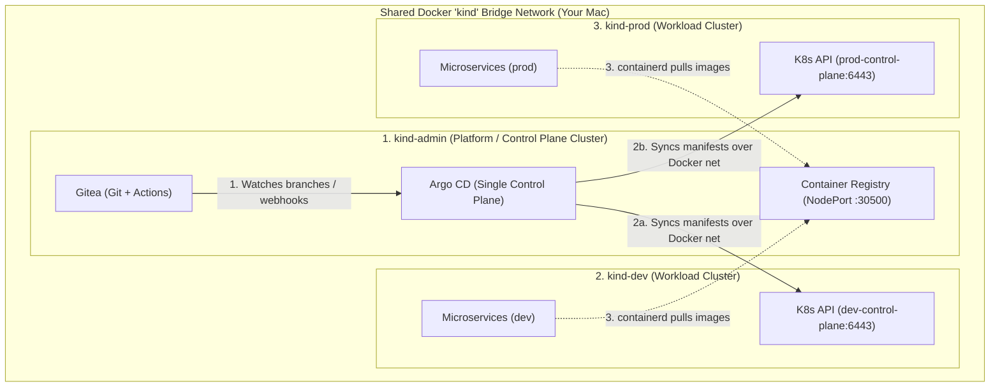
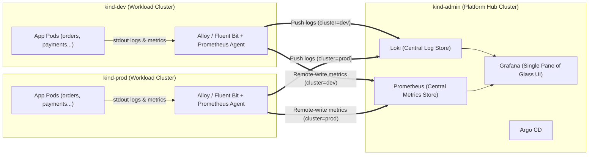

# Raw Session Transcript: Kubernetes Platform Engineering & GitOps Architecture Review

- **Date:** 2026-11-03
- **Workspace:** `/Users/luis/Projects/alfredok8s/kubernetes-terraform-lab`
- **Conversation ID:** `46409c25-95a3-4b3a-9009-a707f5bad78c`

---

## Turn 1

### User
> explain this project, read thoroughly INSTALL.md and README.md

### Assistant
> **Note:** There is no `INSTALL.md` in this repository—all setup, installation, and deployment instructions live in [README.md](file:///Users/luis/Projects/alfredok8s/kubernetes-terraform-lab/README.md) and [CLAUDE.md](file:///Users/luis/Projects/alfredok8s/kubernetes-terraform-lab/CLAUDE.md), both of which I read thoroughly.

#### Project Overview

**`kubernetes-terraform-lab`** is a local Kubernetes + **Argo CD (GitOps)** lab running on a `kind` cluster (`kind-terraform-lab`). Despite the repo name, **Terraform is retired** ([main.tf](file:///Users/luis/Projects/alfredok8s/kubernetes-terraform-lab/main.tf) and [outputs.tf](file:///Users/luis/Projects/alfredok8s/kubernetes-terraform-lab/outputs.tf) are empty; [modules/web-app](file:///Users/luis/Projects/alfredok8s/kubernetes-terraform-lab/modules/web-app/main.tf) is kept only for reference/reuse). All workloads are deployed via **Argo CD** and **Kustomize**.

---

#### Applications & Services

1. **`temp-converter`** ([app/server.js](file:///Users/luis/Projects/alfredok8s/kubernetes-terraform-lab/app/server.js))
   - Express web UI and API (`/api/convert?from=c&value=100`, `/healthz`) for Celsius ↔ Fahrenheit conversion.
   - Managed by a single Argo CD `Application` ([argocd/application.yaml](file:///Users/luis/Projects/alfredok8s/kubernetes-terraform-lab/argocd/application.yaml)) pointing to [k8s/temp-converter](file:///Users/luis/Projects/alfredok8s/kubernetes-terraform-lab/k8s/temp-converter/kustomization.yaml), tracking the `master` branch and deploying into the `argocd-lab` namespace.

2. **Microservices Demo (`orders-api`, `payments-api`, `inventory-api`)**
   - Dependency-free Node.js HTTP services in `k8s/base/<service>/src/server.js`.
   - **Call flow:** `POST /orders` on `orders-api` (`{"productId": "A1", "quantity": 2, "amount": 50}`) calls `inventory-api` (`POST /reserve`), then `payments-api` (`POST /charge`), returning `201` with both results.
   - **Built-in failure simulation:**
     - `productId: "OUT-OF-STOCK"` → `409 Conflict`
     - `amount > 1000` → `402 Payment Required`
     - Invalid payload → `400 Bad Request`
     - Unreachable/failing upstream dependency → `502 Bad Gateway`

---

#### GitOps & Kustomize Architecture

- **Matrix `ApplicationSet`** ([argocd/microservices-appset.yaml](file:///Users/luis/Projects/alfredok8s/kubernetes-terraform-lab/argocd/microservices-appset.yaml)): Generates **6 Argo CD Applications** (`{orders,payments,inventory}-api-{dev,staging}`).
- **Branch-per-environment:**
  - `dev` apps track the `dev` Git branch (`k8s/overlays/dev/<service>`) and deploy to the `dev` namespace (`LOG_LEVEL=debug`).
  - `staging` apps track the `staging` Git branch (`k8s/overlays/staging/<service>`) and deploy to the `staging` namespace (`LOG_LEVEL=info`).
- **Sync Policy:** All apps have automated sync (`prune: true`, `selfHeal: true`, `CreateNamespace=true`). Argo CD reads solely from GitHub (authenticated via the `repo-k8s-lab` secret in the `argocd` namespace), so local changes only take effect once committed and pushed to the target branch.

---

#### Setup, Build, Promotion & Release Workflow

1. **Private Repo Auth in Argo CD:**
   Create the `repo-k8s-lab` secret in namespace `argocd` with a fine-grained GitHub token (`Contents: Read-only`) labeled `argocd.argoproj.io/secret-type=repository`.
2. **Bootstrap Argo CD Resources:**
   ```sh
   kubectl apply -f argocd/application.yaml -f argocd/microservices-appset.yaml
   ```
3. **Build, Load into `kind`, and Bump Overlay Tag:**
   Because `kind` has no container registry, [scripts/build-and-load.sh](file:///Users/luis/Projects/alfredok8s/kubernetes-terraform-lab/scripts/build-and-load.sh) builds the Docker image locally, runs `kind load docker-image`, and updates `newTag` in the target Kustomize overlay:
   ```sh
   git switch dev
   scripts/build-and-load.sh orders   # builds, loads into kind, bumps tag in dev overlay
   git add k8s && git commit -m "orders dev -> <tag>" && git push origin dev
   ```
4. **Promote `dev` → `staging`:**
   Use [scripts/set-image.sh](file:///Users/luis/Projects/alfredok8s/kubernetes-terraform-lab/scripts/set-image.sh) after merging `dev` into `staging`:
   ```sh
   git switch staging
   git merge dev
   scripts/set-image.sh orders staging --from dev
   git add k8s && git commit -m "promote orders to staging" && git push origin staging
   ```

---

#### Testing & CI

- Uses Node's built-in test runner (`node >= 22`, zero npm dependencies; see [package.json](file:///Users/luis/Projects/alfredok8s/kubernetes-terraform-lab/package.json)):
  - `npm run test:services`: Runs unit/integration tests ([tests/payments.test.js](file:///Users/luis/Projects/alfredok8s/kubernetes-terraform-lab/tests/payments.test.js), [tests/inventory.test.js](file:///Users/luis/Projects/alfredok8s/kubernetes-terraform-lab/tests/inventory.test.js), [tests/orders.test.js](file:///Users/luis/Projects/alfredok8s/kubernetes-terraform-lab/tests/orders.test.js)) and full 3-service E2E tests ([tests/e2e.test.js](file:///Users/luis/Projects/alfredok8s/kubernetes-terraform-lab/tests/e2e.test.js)).
  - `npm run test:manifests`: Runs [tests/manifests.test.js](file:///Users/luis/Projects/alfredok8s/kubernetes-terraform-lab/tests/manifests.test.js), validating `kubectl kustomize` output across all `dev`/`staging` overlays and checking the `ApplicationSet`.
- **GitHub Actions CI** (`.github/workflows/test.yml`): Runs `npm test` on pushes and PRs to `master`, `dev`, and `staging`.

---

## Turn 2

### User
> my mistake, the file is called INSTALLATION.md and it should have been referenced in the README.md you read

### Assistant
Found it! `INSTALLATION.md` (and the link to it in [README.md](file:///Users/luis/Projects/alfredok8s/kubernetes-terraform-lab/README.md)) lives on the **`dev` branch** (added in commit `4cb0f9d`, `"update the readme"`), whereas your working tree is currently checked out on **`master`** (where you committed `fbf2bc4`, `"Point Argo CD at my repository"`).

Here is the complete breakdown of **`INSTALLATION.md`** (read from `dev:INSTALLATION.md`) and how it fits with **[README.md](file:///Users/luis/Projects/alfredok8s/kubernetes-terraform-lab/README.md)**.

---

#### What `INSTALLATION.md` Covers (Step-by-Step Bootstrap from Scratch)

While [README.md](file:///Users/luis/Projects/alfredok8s/kubernetes-terraform-lab/README.md) documents the architecture and day-to-day workflow, `INSTALLATION.md` walks through standing up the entire lab from zero in 10 steps:

1. **Prerequisites:**
   - **Docker** (tested with v26), **kind** (v0.20 / K8s 1.27), **kubectl** (1.27+), **Node.js** (`>= 22` for running the built-in test runner), **git**, and a **GitHub account**.
   - Explicitly notes that **Terraform is not needed**.

2. **Fork/Clone & Point Argo CD at Your Repo:**
   - Because Argo CD syncs directly from GitHub rather than your local disk, you clone your own repo and update `repoURL` in [argocd/application.yaml](file:///Users/luis/Projects/alfredok8s/kubernetes-terraform-lab/argocd/application.yaml) and [argocd/microservices-appset.yaml](file:///Users/luis/Projects/alfredok8s/kubernetes-terraform-lab/argocd/microservices-appset.yaml) (which you already did on `master` in commit `fbf2bc4` → `https://github.com/onedeveloper/kubernetes-terraform-lab.git`).
   - Push `master` (used by `temp-converter`), and create/push the `dev` and `staging` branches (used by the microservices environments).

3. **Run the Tests (`npm test`):**
   - Runs zero-dependency tests in [tests/](file:///Users/luis/Projects/alfredok8s/kubernetes-terraform-lab/tests) using Node's native test runner (`node --test`) plus `kubectl kustomize` validation in [tests/manifests.test.js](file:///Users/luis/Projects/alfredok8s/kubernetes-terraform-lab/tests/manifests.test.js).

4. **Create the `kind` Cluster (`terraform-lab`):**
   - `kind create cluster --name terraform-lab` (sets kubectl context to `kind-terraform-lab`).
   - Must be named `terraform-lab` because [scripts/build-and-load.sh](file:///Users/luis/Projects/alfredok8s/kubernetes-terraform-lab/scripts/build-and-load.sh) loads images into that cluster name by default.

5. **Install Argo CD (v3.5.6):**
   - Creates namespace `argocd` and installs Argo CD using `kubectl apply -n argocd --server-side -f https://raw.githubusercontent.com/argoproj/argo-cd/v3.5.6/manifests/install.yaml` (`--server-side` prevents CRD annotation length errors).
   - Explains how to port-forward `svc/argocd-server` on `https://localhost:8081` and retrieve the `admin` password from `argocd-initial-admin-secret`.

6. **Configure Private Repo Credentials (if private):**
   - Creates a GitHub fine-grained PAT (`Contents: Read-only`) and stores it in K8s secret `repo-k8s-lab` in namespace `argocd` with label `argocd.argoproj.io/secret-type=repository`.

7. **Pre-build & Load Docker Images into `kind`:**
   - Since `kind` has no container registry, all service images must be built locally and loaded via `kind load docker-image ... --name terraform-lab` **before** Argo CD syncs (otherwise pods fail with `ErrImagePull`).
   - Loops through `orders`, `payments`, and `inventory` tags in `k8s/overlays/*/<svc>/kustomization.yaml` and builds `k8s/base/<svc>`, plus builds `temp-converter` from [app/](file:///Users/luis/Projects/alfredok8s/kubernetes-terraform-lab/app).

8. **Register the Argo CD Applications:**
   - `kubectl apply -f argocd/application.yaml -f argocd/microservices-appset.yaml`
   - Creates **7 Applications** total:
     - `temp-converter` → namespace `argocd-lab` (tracks `master`)
     - `{orders,payments,inventory}-api-dev` → namespace `dev` (tracks `dev`)
     - `{orders,payments,inventory}-api-staging` → namespace `staging` (tracks `staging`)

9. **Verify & Port-Forward:**
   - Check `kubectl -n argocd get applications` until `Synced` / `Healthy`.
   - Port-forward `svc/temp-converter` (`8080:80`) or `svc/orders-api` (`8082:80`) and test via `http://localhost:...`.

10. **Branch Protection & Troubleshooting:**
    - Recommends requiring the GitHub Actions `test` status check on `master`, `dev`, and `staging` so broken manifests or code cannot be merged and auto-synced by Argo CD.
    - Includes a troubleshooting table covering `Repository not found`, `ErrImagePull`, `ComparisonError` (missing branch/path), manual hard refresh annotations, and `SSL_ERROR_RX_RECORD_TOO_LONG` (using `https://` instead of `http://` on app port-forwards).

---

#### Quick Heads-Up About Your Current Git Branches

Because you switched to `master` during Step 2 (`fbf2bc4`):
- Your **`master`** branch has your updated `repoURL` (`github.com/onedeveloper/kubernetes-terraform-lab.git`), but is a few commits behind `dev` (so it doesn't have `INSTALLATION.md`).
- Your **`dev`** and **`origin/staging`** branches still have the original owner's `repoURL` (`github.com/alfredopatnella/kubernetes-terraform-lab.git`) in `argocd/*.yaml`.

Would you like me to bring `INSTALLATION.md` onto `master` or sync the updated `repoURL` across `dev` and `staging`?

---

## Turn 3

### User
> this is a fork, i am just inspecting the project... dont change anything that will make a future merge more difficult

### Assistant
Understood—nothing has been modified. Every command run so far was strictly read-only (`git status`, `git log`, `git show`), so your working tree and branch history are completely untouched.

Let me know if there's any other part of the codebase, manifests, scripts, or tests you'd like to inspect!

---

## Turn 4

### User
> can you access files one hierarchy level above current project?

### Assistant
Yes, I can access `/Users/luis/Projects/alfredok8s`. Currently, it contains:

- [kubernetes_gitops_local_platform_engineering_lab.md](file:///Users/luis/Projects/alfredok8s/kubernetes_gitops_local_platform_engineering_lab.md)
- [github_pat.txt](file:///Users/luis/Projects/alfredok8s/github_pat.txt)
- `kubernetes-terraform-lab/` (the current project directory)

Would you like me to read or work with [kubernetes_gitops_local_platform_engineering_lab.md](file:///Users/luis/Projects/alfredok8s/kubernetes_gitops_local_platform_engineering_lab.md)?

---

## Turn 5

### User
> yes, please, use the concepts in there, compare it to this project. focus the comparition at the conceptual or fundamental level, like what the infrastructure is, what the project goals are, etc while ignoring superfluos differences like the deployed application is different.

### Assistant
At a fundamental level, both [kubernetes_gitops_local_platform_engineering_lab.md](file:///Users/luis/Projects/alfredok8s/kubernetes_gitops_local_platform_engineering_lab.md) (the **Reference Guide**) and `kubernetes-terraform-lab` (this **Repository**) share the exact same core thesis: **building a local, zero-cloud-cost Kubernetes Platform Engineering environment where Git is the single source of truth, Kustomize manages environment configuration, and Argo CD continuously reconciles cluster state (`prune` + `selfHeal`).**

However, they make very different architectural trade-offs across **five fundamental platform dimensions**:

---

#### 1. Project Goals & Pedagogical Focus

| Dimension | Reference Guide (`kubernetes_gitops_local_platform_engineering_lab.md`) | This Project (`kubernetes-terraform-lab`) |
| :--- | :--- | :--- |
| **Primary Goal** | **Infrastructure & Edge Networking realism:** Teach how a modern local platform stack looks end-to-end (multi-node cluster, container registry, Gateway API ingress, GitOps). | **SDLC, Multi-Service Promotion & GitOps Governance:** Teach how multiple services are tested, versioned, isolated across environments, and promoted safely through Git branches and CI gates. |
| **System Topology** | **North–South (Client → Edge → Service):** Focuses on how external traffic enters the cluster and routes to a single backend. | **East–West (Service → Service → Service):** Focuses on in-cluster service discovery (`orders-api` → `inventory-api` → `payments-api`), failure propagation, and environment isolation. |

---

#### 2. Container Image Supply Chain (Registry vs. Direct Node Side-Loading)

A foundational problem in local Kubernetes (Kind) is: *how does `containerd` inside the Kind node get locally built images?*

- **Reference Guide (Local OCI Registry + Containerd Mirroring):**
  - Runs a standalone `registry:2` container (`localhost:5001`) attached to the `kind` Docker network and patches Kind's `containerd` config plus the `kube-public/local-registry-hosting` ConfigMap (KEP-1755).
  - **Conceptually:** Mirrors production closely (`docker build` → `docker push` → Kubelet pulls over HTTP from a registry).
- **This Project (Direct Node Injection via `kind load`):**
  - Runs no registry at all. Instead, [scripts/build-and-load.sh](file:///Users/luis/Projects/alfredok8s/kubernetes-terraform-lab/scripts/build-and-load.sh) builds the image and streams the tarball directly into the Kind node's `containerd` store via `kind load docker-image`, paired with `imagePullPolicy: IfNotPresent`.
  - **Conceptually:** Eliminates registry infrastructure overhead, but introduces a strict coupling between the local node's image cache and Git state—which is why [scripts/set-image.sh](file:///Users/luis/Projects/alfredok8s/kubernetes-terraform-lab/scripts/set-image.sh) explicitly inspects `crictl images` inside the Kind container before allowing an overlay tag bump.

---

#### 3. Cluster Topology & Traffic Ingress Model

- **Reference Guide (Multi-Node + Gateway API / Envoy Gateway):**
  - Provisions **1 control-plane + 2 worker nodes** with `extraPortMappings` binding host ports `80`/`443` into the cluster.
  - Installs **Kubernetes Gateway API CRDs** and **Envoy Gateway** (`GatewayClass`, `Gateway`, and per-app `HTTPRoute` with host-based routing like `calc.local` vs `calc.prod.local`).
  - **Conceptually:** Treats ingress as a first-class platform concern managed alongside the workload in Kustomize.
- **This Project (Single-Node + `ClusterIP` Only):**
  - Uses a default single-node Kind cluster (`terraform-lab-control-plane`) with no Ingress or Gateway controller.
  - All services are internal `ClusterIP` resources accessed by developers via `kubectl port-forward`, while microservices talk to each other over core Kubernetes DNS (`http://inventory-api`, `http://payments-api`) scoped to their own namespace.
  - **Conceptually:** Strips away edge networking so the lab stays focused on GitOps sync mechanics, inter-service communication, and environment promotion.

---

#### 4. GitOps Branching, Scaling & Promotion Strategy

This is the sharpest conceptual divergence between the two designs:

- **Reference Guide (Single-Branch / Folder-Based Environments + Manual `Application`):**
  - Uses `targetRevision: HEAD` on a single branch, separating environments purely by directory (`gitops/envs/dev`, `gitops/envs/prod`).
  - Uses individual Argo CD `Application` manifests.
  - Uses `namePrefix: dev-` / `prod-` and JSON patches in overlays, while suggesting bumping the image tag directly in `gitops/base/deployment.yaml` (which would simultaneously mutate `dev` and `prod` unless overridden per overlay).
- **This Project (Branch-per-Environment + Matrix `ApplicationSet` + Overlay Pinning):**
  - Uses an Argo CD **Matrix `ApplicationSet`** ([argocd/microservices-appset.yaml](file:///Users/luis/Projects/alfredok8s/kubernetes-terraform-lab/argocd/microservices-appset.yaml)) that crosses `env/branch` (`dev`, `staging`) × `service` (`orders`, `payments`, `inventory`) to declaratively generate 6 `Application` resources.
  - **Double isolation (Branch + Overlay):** `dev` apps track the `dev` Git branch (`k8s/overlays/dev/<svc>`); `staging` apps track the `staging` Git branch (`k8s/overlays/staging/<svc>`). Pushing to `dev` cannot affect `staging`.
  - **Clean Kustomize separation:** Base manifests ([k8s/base/](file:///Users/luis/Projects/alfredok8s/kubernetes-terraform-lab/k8s/base)) contain zero environment opinions (no namespace, no image tag). Overlays ([k8s/overlays/dev/orders/kustomization.yaml](file:///Users/luis/Projects/alfredok8s/kubernetes-terraform-lab/k8s/overlays/dev/orders/kustomization.yaml)) control `namespace`, `replicas`, `images.newTag`, and strategic-merge `LOG_LEVEL` patches.
  - **Promotion as an immutable artifact flow:** You build once for `dev`, verify, `git merge dev` into `staging`, and run `scripts/set-image.sh <svc> staging --from dev` to promote the exact tested image tag.

---

#### 5. Day-2 Governance, Testing & Automation

- **Reference Guide (Imperative Bootstrap, Manual Day-2):**
  - Automates **Day-0/Day-1 infrastructure provisioning** via a single `setup-lab.sh` script, but leaves **Day-2 releases** manual (hand-editing YAML tags) and has no automated validation or CI pipeline.
- **This Project (Manual Day-1 Bootstrap, Automated Day-2 Release & Policy Gates):**
  - Day-1 cluster setup is documented as manual steps in `INSTALLATION.md`, while **Day-2 operations are heavily automated and guarded**:
    - **Release CLIs:** [scripts/build-and-load.sh](file:///Users/luis/Projects/alfredok8s/kubernetes-terraform-lab/scripts/build-and-load.sh) and [scripts/set-image.sh](file:///Users/luis/Projects/alfredok8s/kubernetes-terraform-lab/scripts/set-image.sh) automate semantic patch bumping, Kustomize tag updates, node-image verification, and Git branch sanity warnings.
    - **Policy-as-Code / Manifest Tests:** [tests/manifests.test.js](file:///Users/luis/Projects/alfredok8s/kubernetes-terraform-lab/tests/manifests.test.js) acts as a platform guardrail—rendering every overlay with `kubectl kustomize` and asserting invariants (pinned `x.y.z` string tags, matching ports/probes/selectors, resource requests/limits present, no hardcoded `Namespace` objects, and exact alignment between the `ApplicationSet` matrix and filesystem directories).
    - **CI as a GitOps Gatekeeper:** Because Argo CD auto-syncs `dev` and `staging`, GitHub Actions (`.github/workflows/test.yml`) + branch protection ensure no commit can land on an environment branch unless both service E2E tests and Kustomize manifest invariants pass.

---

#### Summary Takeaway

Think of the two as complementary halves of a complete platform engineering blueprint:
- **[kubernetes_gitops_local_platform_engineering_lab.md](file:///Users/luis/Projects/alfredok8s/kubernetes_gitops_local_platform_engineering_lab.md)** is strong on **cluster-level platform plumbing** (automated Kind bootstrap, local OCI registry with containerd mirrors, multi-node topology, and Gateway API / Envoy ingress).
- **`kubernetes-terraform-lab`** is much more mature on **GitOps software delivery lifecycle (SDLC)** (multi-service matrix `ApplicationSet`, strict Kustomize base/overlay hygiene, release/promotion tooling, and automated manifest/E2E CI gates).

---

## Turn 6

### User
> what about the gitops? how does that look like? it is my understanding that the project uses/relies on github actions. hopefully the guide uses fully local actions

### Assistant
Here is how GitOps and CI/Actions actually work in both projects—including an important clarification about what **GitHub Actions** is (and isn't) doing in this repo, and a subtle gap in the Reference Guide regarding "fully local" GitOps.

---

#### 1. Does `kubernetes-terraform-lab` rely on GitHub Actions for GitOps?

**No—GitHub Actions is not involved in deploying or building anything.**

In `kubernetes-terraform-lab`, the GitOps loop is **pull-based** from inside your local cluster, and all image building/tag bumping happens **locally on your machine**:

1. **Local Build & Tag (Your Mac):**
   You run [scripts/build-and-load.sh](file:///Users/luis/Projects/alfredok8s/kubernetes-terraform-lab/scripts/build-and-load.sh) or [scripts/set-image.sh](file:///Users/luis/Projects/alfredok8s/kubernetes-terraform-lab/scripts/set-image.sh) locally. That script builds the Docker image on your Mac, injects it directly into your local `kind` cluster (`kind load docker-image`), and edits `newTag` in your local `k8s/overlays/<env>/<svc>/kustomization.yaml`.
2. **Git Push (Your Mac → GitHub.com):**
   You `git commit` and `git push` to GitHub (`dev`, `staging`, or `master`).
3. **GitOps Pull & Reconcile (Local Argo CD ← GitHub.com):**
   Argo CD (running locally inside your `kind` cluster) polls `https://github.com/...` using your read-only `repo-k8s-lab` Secret, sees the new commit on that branch, renders the Kustomize overlay, and updates the local Kubernetes Deployment.

**What does GitHub Actions (`.github/workflows/test.yml`) actually do?**
- It has `permissions: contents: read` and runs a single command: `npm test`.
- It **never** builds Docker images, **never** commits to Git, and **cannot** talk to your local `kind` cluster.
- It is purely an **optional PR gatekeeper**: if you enable GitHub branch protection, it prevents you from merging a broken Kustomize overlay or failing service code into `dev`/`staging` before Argo CD pulls it. Even if you disable GitHub Actions completely, the entire GitOps deployment pipeline works identically (you can just run `npm test` locally before pushing).

> **Summary for this project:** Compute, image building, Kustomize tag updates, and Argo CD reconciliation are **100% local**, **except** that GitHub.com is used as the hosted Git remote that local Argo CD polls.

---

#### 2. How does the Reference Guide ([kubernetes_gitops_local_platform_engineering_lab.md](file:///Users/luis/Projects/alfredok8s/kubernetes_gitops_local_platform_engineering_lab.md)) do it?

The Reference Guide has **zero CI/Actions**—every step is executed locally in your terminal:
1. You build and push to the local registry container (`docker push localhost:5001/calculator-api:v2`).
2. You edit the YAML tag locally and `git commit`.
3. Argo CD reconciles the change.

**However, watch out for a catch in the Reference Guide (Steps 4 & 5):**
- In [Step 4 (lines 350–359)](file:///Users/luis/Projects/alfredok8s/kubernetes_gitops_local_platform_engineering_lab.md#L350-L359), the guide runs `git init` inside a local folder (`gitops/`) on your Mac.
- **Argo CD running inside a Kind container cannot read a local folder on your Mac's filesystem** over a file path—Argo CD's `repo-server` pod needs a network-reachable Git URL (`http://`, `https://`, or `ssh://`).
- Because of that, in [Step 5 (line 382)](file:///Users/luis/Projects/alfredok8s/kubernetes_gitops_local_platform_engineering_lab.md#L382) the guide's `Application` YAML still points to GitHub (`repoURL: 'https://github.com/your-org/platform-lab.git'`), and adds a note in [line 361](file:///Users/luis/Projects/alfredok8s/kubernetes_gitops_local_platform_engineering_lab.md#L361):
  > *"If working strictly offline, you can push this to an in-cluster Gitea instance or run a simple local Git server."*
  *(Note: `setup-lab.sh` in the guide does not actually install Gitea or a local Git server—it leaves that up to you.)*

---

#### Side-by-Side: What Runs Where?

| Step in the GitOps Loop | `kubernetes-terraform-lab` (This Repo) | `kubernetes_gitops_local_platform_engineering_lab.md` (Guide) |
| :--- | :--- | :--- |
| **1. Test Execution (CI)** | **Local** (`npm test`) **+ GitHub Actions** (on PR/push) | **None** (manual `curl` check after deploy) |
| **2. Image Build** | **Local** (`scripts/build-and-load.sh` on your Mac) | **Local** (`docker build` on your Mac) |
| **3. Image Storage** | **Local** (loaded directly into Kind node `containerd`) | **Local** (`localhost:5001` Docker `registry:2` container) |
| **4. Manifest / Tag Update** | **Local** (`scripts/build-and-load.sh` / `scripts/set-image.sh`) | **Local** (manual file edit) |
| **5. Git Hosting (Argo CD Source)** | **GitHub.com** (private or public repo polled by local Argo CD) | **GitHub.com** by default in Step 5 *(or bring-your-own local Gitea/Git server)* |
| **6. CD / Reconciliation** | **Local** (Argo CD inside `kind` cluster) | **Local** (Argo CD inside `kind` cluster) |

#### If your goal is 100% Offline / Zero-GitHub GitOps

If you want neither GitHub.com nor GitHub Actions involved at all:
- You replace GitHub.com with a lightweight **Gitea** container (or `git daemon` / `git http-backend` container) attached to the `kind` Docker network (just like `kind-registry` in the guide).
- And if you want "local GitHub Actions" to run `npm test` automatically before commits or on push to local Gitea, you can use either:
  - A local Git `pre-push` hook that runs `npm test`, or
  - **Gitea Actions** (which uses the exact same `.github/workflows/test.yml` syntax with a local `act_runner` container).

---

## Turn 7

### User
> how expensive would it be to run the gitea container?

### Assistant
Very cheap—Gitea is written in Go as a single binary and uses SQLite by default, so it has one of the smallest footprints of any self-hosted Git platform.

#### Resource Cost on Your Mac (Docker / OrbStack)

| Component | Idle RAM | Active RAM (Push / Clone / UI) | Idle CPU | Disk Image Size | Startup Time |
| :--- | :--- | :--- | :--- | :--- | :--- |
| **Gitea (`gitea/gitea:latest` w/ SQLite)** | **~80–120 MB** | **~150–200 MB** | **< 0.5%** | ~150 MB | ~2–3 seconds |
| **Optional: `act_runner` (Local Actions)** | **~25–40 MB** | + container memory during test run (~200 MB for Node 22) | **~0%** | ~50 MB | ~1 second |
| *(For comparison) Argo CD in Kind* | *~600–900 MB* | *~1+ GB* | *1–3%* | *~400 MB* | *~30–60s* |

In short: **Gitea uses roughly 1/8th the memory of Argo CD itself**, and requires **no external database container** (Postgres/MySQL) if you configure `DB_TYPE=sqlite3`.

---

#### Operational "Cost" (Setup Complexity)

Just like the `kind-registry` container in [kubernetes_gitops_local_platform_engineering_lab.md](file:///Users/luis/Projects/alfredok8s/kubernetes_gitops_local_platform_engineering_lab.md#L60-L91), you can run Gitea as a single Docker container connected to the `kind` bridge network:

1. **Your Mac** talks to it via `http://localhost:3001/<user>/<repo>.git` (`git push`).
2. **Argo CD (inside Kind)** talks to it over the Docker network via `http://gitea:3000/<user>/<repo>.git` (no internet, no GitHub PAT needed if the local repo is public, or a local token created via CLI).
3. **Instant Webhooks (Bonus over GitHub):** Because Gitea and Argo CD are on the same local Docker network, Gitea can send push webhooks directly to `http://argocd-server.argocd.svc...`, meaning Argo CD syncs **instantly on `git push`** instead of waiting up to 3 minutes for polling.

#### Even Lighter Alternative (If You Don't Need a Web UI or PRs)

If you only need a Git endpoint for Argo CD to pull from and don't care about a web UI or Actions:
- A bare **`git daemon`** or **`nginx` + `git-http-backend`** Alpine container uses **~5–10 MB of RAM** and a ~15 MB image.
- However, since Gitea only costs ~100 MB of RAM and gives you a full GitHub-like UI (branches, PRs, commit graph, webhooks, and optional GitHub-compatible Actions), Gitea is almost always worth the tiny extra memory on a modern Mac.

---

## Turn 8

### User
> ok, let me ask you.. and i am not sure if this makes sense or if it is absurd, so please correct me if i am going down a bad path. how would it look like to have an admin cluster with common things ( docker registry, gitea, etc ) and a dev and prod clusters

### Assistant
It is **not absurd at all**—in fact, what you just described is the **industry-standard "Hub-and-Spoke" (Management Cluster + Workload Clusters) architecture** used in real-world Platform Engineering.

In production, platform teams rarely run Argo CD inside the same cluster as production workloads, nor do they mix `dev` and `prod` as mere namespaces on a single cluster (where a noisy neighbor, CRD upgrade, or RBAC mistake in `dev` can take down `prod`).

Here is how a **3-cluster local setup (`admin`, `dev`, `prod`)** looks, where it shines, and the **one technical trap** you need to watch out for on a local machine.

---

#### 1. The Hub-and-Spoke Architecture (Local Kind Edition)

All Kind clusters created on your Mac automatically attach to the same Docker bridge network (`kind`), meaning their control-plane containers can talk to each other directly by container name (`admin-control-plane`, `dev-control-plane`, `prod-control-plane`).



---

#### 2. Why This Makes Total Sense Conceptually

1. **Single Pane of Glass (One Argo CD, Multiple Clusters):**
   You only install Argo CD **once** (in `kind-admin`). You register `kind-dev` and `kind-prod` with Argo CD (`argocd cluster add`), and in your `ApplicationSet` ([argocd/microservices-appset.yaml](file:///Users/luis/Projects/alfredok8s/kubernetes-terraform-lab/argocd/microservices-appset.yaml)), instead of changing only `namespace: "{{env}}"`, you also change `destination.server`:
   ```yaml
   elements:
     - env: dev
       branch: dev
       clusterUrl: https://dev-control-plane:6443
     - env: prod
       branch: prod
       clusterUrl: https://prod-control-plane:6443
   ```
2. **True Blast-Radius Isolation (`dev` vs. `prod`):**
   - `kind-dev` and `kind-prod` have **zero Argo CD pods** running in them—they are pure, lightweight workload clusters.
   - You can test cluster-wide changes in `kind-dev` (Gateway API CRDs, NetworkPolicies, Kubernetes version upgrades) without risking `kind-prod`.
   - Even if you `kind delete cluster --name dev` and recreate it, **Argo CD in `kind-admin` will automatically re-populate `kind-dev` back to its desired state from Gitea.**

---

#### 3. The One Local Trap to Watch Out For: The Registry

Putting **Argo CD** and **Gitea** as Pods inside `kind-admin` works effortlessly. However, putting the **Docker Registry inside `kind-admin`** has two subtle friction points in Kind:

1. **`containerd` runs at the Node level, not the Pod level:**
   When `kind-dev` or `kind-prod` pulls an image, it is the `containerd` daemon inside the `dev-control-plane` Docker container doing the pull. It does **not** know about `kind-admin`'s internal Kubernetes DNS (`registry.admin.svc.cluster.local`).
   - *Fix if inside `kind-admin`:* You must expose the Registry in `kind-admin` via a Kubernetes **`NodePort`** (e.g., port `30500`) + `extraPortMappings` to `localhost:5001`, so `dev` and `prod` nodes can pull from `http://admin-control-plane:30500`.
2. **The Bootstrap Chicken-and-Egg Problem:**
   If Gitea and Argo CD are running inside `kind-admin`, `kind-admin` needs to pull Gitea and Argo CD images *before* your in-cluster Registry Pod even exists.

##### Practical Recommendation (The Hybrid Compromise)
In local platform labs, there are two clean ways to structure the "Admin" layer:
- **Option A (Purist K8s Admin Cluster):** Run Registry + Gitea + Argo CD inside `kind-admin` exposed via `NodePort`s on `admin-control-plane`. Great if your goal is to manage Gitea and the Registry via Kubernetes manifests too.
- **Option B (Pragmatic Appliance Layer + K8s Hub):** Run `registry:2` (and optionally `gitea`) as tiny standalone Docker containers on the `kind` network (taking ~120 MB RAM total and starting in 2 seconds), and use `kind-admin` exclusively for **Kubernetes-native platform controllers** (Argo CD, Prometheus/Grafana, External Secrets, Cert-Manager) managing `kind-dev` and `kind-prod`.

---

#### 4. Resource Cost of Running 3 Kind Clusters (`admin`, `dev`, `prod`)

Because `kind-dev` and `kind-prod` only run the Kubernetes control plane + your lightweight app pods (no Argo CD, no Gitea), the overhead is very reasonable on a modern Mac (16 GB+ RAM):

| Component | Approx. RAM | What Runs Inside |
| :--- | :--- | :--- |
| **`kind-admin` (1 node)** | **~1.2 – 1.5 GB** | K8s Control Plane + Argo CD + Gitea + Registry |
| **`kind-dev` (1 node)** | **~450 – 600 MB** | K8s Control Plane + Dev Microservices (+ Gateway if used) |
| **`kind-prod` (1 node)** | **~450 – 600 MB** | K8s Control Plane + Prod Microservices (+ Gateway if used) |
| **Total Lab Footprint** | **~2.2 – 2.7 GB RAM** | Complete 3-cluster enterprise GitOps topology |

*(Tip: Keep `admin`, `dev`, and `prod` as **single-node** Kind clusters rather than the 3-node cluster in the Reference Guide—extra Kind worker nodes on the same Mac add ~350 MB of `kubelet`/`containerd` overhead per node without adding real isolation.)*

---

## Turn 9

### User
> ok, is there an advantage to run ArgoCD, Gitea, Registry on the admin? what if we avoid the chicken and egg problem and just spin them as containers with docker compose or something?

### Assistant
Your instinct is spot-on for **Gitea and Registry**, and leads to a critical architectural distinction between **foundational appliances** (Gitea, Registry) and **Kubernetes-native controllers** (Argo CD).

---

#### 1. Gitea & Registry in `docker compose`: **100% Yes (Best Practice)**

Running **Gitea** (plus optional `act_runner` for local Actions) and **Docker Registry** in `docker compose` outside of Kind is actually **much better** than putting them inside an `admin` Kubernetes cluster:

1. **Matches Real-World Cloud Architecture:**
   In production, you rarely self-host your Git server and OCI Registry inside the very Kubernetes cluster they bootstrap—you use external services (GitHub/GitLab + ECR/GAR/Artifactory). A `docker-compose.yml` on the `kind` network simulates that external foundation.
2. **Survives Cluster Wipes (`kind delete cluster`):**
   If Gitea and Registry are in `docker compose`, you can destroy and recreate your Kind clusters 10 times a day while **keeping all your Git history, branches, PRs, and pre-built Docker images intact**.
3. **Eliminates Every Chicken-and-Egg & Networking Problem:**
   - Your Mac accesses `localhost:3000` (Gitea) and `localhost:5001` (Registry).
   - Every Kind cluster on the `kind` Docker network accesses `http://gitea:3000` and `http://registry:5000` natively.

---

#### 2. Why Argo CD is Different (Why It Needs Kubernetes)

Unlike Gitea (which uses SQLite) or Registry (which uses the filesystem), **Argo CD cannot run standalone in `docker compose` without a Kubernetes cluster.**

- **Kubernetes *is* Argo CD's database:** Argo CD has no SQL database. Every `Application`, `ApplicationSet`, `AppProject`, and repository credential (`repo-k8s-lab`) is stored in `etcd` as a **Kubernetes Custom Resource (CRD)** or **Kubernetes Secret** inside a Kubernetes API server.
- Its components (`argocd-application-controller`, `argocd-applicationset-controller`, `argocd-server`, `argocd-repo-server`, `redis`) are built as Kubernetes controllers that watch the Kubernetes API.

---

#### 3. So Do You Still Need an `admin` Cluster?

Once Gitea and Registry move to `docker compose`, the question *"Should I have a `kind-admin` cluster just for Argo CD, plus `kind-dev` and `kind-prod`?"* comes down to a simple trade-off:

| Architecture | How It Works | Pros | Cons |
| :--- | :--- | :--- | :--- |
| **A. `docker compose` (Gitea + Registry) + 3 Clusters (`admin`, `dev`, `prod`)** | `kind-admin` runs Argo CD (the hub) and deploys to `kind-dev` and `kind-prod` (spokes). | - **True Hub-and-Spoke:** You can delete/recreate `kind-dev` or `kind-prod` without killing Argo CD.<br>- Great if you later add other K8s-native hub tools (Crossplane, Vault, Central Grafana). | Costs **~600 MB extra RAM** just for `kind-admin`'s control plane to host Argo CD. |
| **B. `docker compose` (Gitea + Registry) + 2 Clusters (`dev`, `prod`)** | Argo CD lives in the `argocd` namespace of `kind-dev`, and deploys locally to `kind-dev` **and** remotely to `kind-prod`. | - Saves a 3rd Kubernetes control plane (~600 MB RAM).<br>- Still practices multi-cluster Argo CD (`dev` → `prod`). | Deleting `kind-dev` also deletes Argo CD. |
| **C. `docker compose` (Gitea + Registry) + 1 Cluster (`lab`)** | Single Kind cluster where Argo CD deploys to `dev`, `staging`, and `prod` namespaces (like this repo). | - Lightest (~1.2 GB RAM total).<br>- Simplest setup. | Namespace isolation only (no multi-cluster practice). |

#### Bottom Line

Moving **Gitea + Registry (+ Actions Runner)** into **`docker compose`** is a huge improvement over running them inside Kubernetes. From there, whether Argo CD sits in its own dedicated `kind-admin` cluster (Option A) or inside `kind-dev` (Option B) just depends on whether you want **`kind-dev` to be disposable without losing Argo CD**.

---

## Turn 10

### User
> ok, now i have more questions:
> 1. ArgosCD is for CI/CD workflow in kubernetes, is this the best option? what are the alternatives? what is the standard? what would give me the best path to actual production environment?
> 2. the docker registry seems very basic, you mentioned as alternatives ECR,GAR, Artifactory. should i use one of those instead? what would be the best path to a Production environment?
>
> this questions are meant to test the learning path from local lab to "I am ready to operate or admin a production environment for a company"

### Assistant
These two questions get straight to the heart of what separates a "toy tutorial" from **actual production platform engineering**.

---

#### Question 1: Is Argo CD the best option for CI/CD? What is the production standard?

##### First, a critical production distinction: **Argo CD is ONLY the "CD", not the "CI"**
In a real production company, **CI (Continuous Integration)** and **CD (Continuous Delivery)** are strictly separated for security and reliability:

1. **CI (Outside the cluster — GitHub Actions, GitLab CI, Gitea Actions, Tekton):**
   - Runs when code is pushed.
   - Runs unit/integration tests, scans for vulnerabilities, builds the container image, pushes the image to the Registry, and opens a PR or commits the new image tag to the GitOps repository.
   - **Crucially:** The CI pipeline has **zero credentials** to your production Kubernetes cluster.
2. **CD (Inside the cluster — Argo CD):**
   - Watches the GitOps repository, pulls the approved manifests, applies them to the cluster, detects manual drift (`selfHeal`), and cleans up deleted resources (`prune`).

##### What is the industry standard for Kubernetes CD?

| Tool | Market Position | Where It Fits in Production |
| :--- | :--- | :--- |
| **1. Argo CD** *(CNCF Graduated)* | **The clear industry standard (~65%+ of K8s GitOps adoption)** | Used by startups and Fortune 500s alike. Best-in-class UI, multi-cluster hub-and-spoke architecture, `ApplicationSet` automation, SSO/RBAC, and pairs with **Argo Rollouts** (Canary / Blue-Green deploys). |
| **2. Flux CD** *(CNCF Graduated)* | **The #2 standard (~25–30% adoption)** | CLI/CRD-only (no built-in UI), very modular. Popular in pure-CLI infrastructure teams and baked into Azure AKS. If you know Argo CD deeply, you can learn Flux in an afternoon. |
| **3. Push-based CI (`helm upgrade` / `kubectl apply` inside GitHub Actions)** | **Legacy / Early-stage pattern** | Common in small teams without a dedicated platform engineer. Falls apart at scale because CI needs cluster-admin credentials and cannot detect or self-heal cluster drift. |

**Verdict for your career path:**
**Stick with Argo CD.** It is the #1 most requested GitOps tool in Platform Engineering, SRE, and DevOps job descriptions. To move from "lab level" to "production admin level" with Argo CD, focus on:
- **`ApplicationSet`s** (which this repo already uses!) and the **App-of-Apps** pattern (where Argo CD deploys cluster add-ons like Ingress, Cert-Manager, and Prometheus, not just user apps).
- **Argo CD `AppProject`s & RBAC** (restricting which teams can deploy to which namespaces/clusters).
- **Secrets Management in GitOps** (since you can't commit raw secrets to Git: **External Secrets Operator (ESO)** or **Sealed Secrets**).

---

#### Question 2: Is `registry:2` too basic? Should I use ECR, GAR, Artifactory, or something else?

Under the hood, **every registry on earth** (`registry:2`, AWS ECR, Google GAR, Artifactory, Harbor, GHCR) speaks the exact same **OCI Distribution HTTP API** when `docker push` or `containerd` pulls an image.

Where `registry:2` falls short of production is **governance and security**:
- `registry:2` has **no authentication** (`docker push` is wide open), **no UI**, **no vulnerability scanning**, and **no access control**.
- In production, Kubernetes needs **credentials** (`imagePullSecrets` or Cloud IAM) to pull private images, and CI pipelines scan images for CVEs before deployment.

##### Your 3 Options (and Which Gives the Best Path to Production)

###### Option 1: Use Gitea's Built-In Container Registry (Best Local Lab Upgrade — 0 MB Extra RAM)
Most people don't realize that **Gitea already has a full OCI Container Registry built right into it!**
- If you run Gitea in `docker compose`, you don't even need the `registry:2` container.
- You run `docker login gitea:3000`, `docker push gitea:3000/my-org/orders-api:1.0.3`, and view all your container images and tags right inside Gitea's web UI alongside your Git repository.
- **Why this teaches real production skills:** Because Gitea's registry supports private images and token auth, it forces you to configure **Kubernetes `imagePullSecrets`** (`kubectl create secret docker-registry ...`) in your deployments—which is one of the most common day-1 tasks in real companies.

###### Option 2: Harbor (The On-Prem / Enterprise Self-Hosted Standard)
If a company runs its own registry instead of using AWS/GCP, they almost always run **Harbor** (CNCF Graduated) or **JFrog Artifactory**.
- Harbor gives you **Trivy vulnerability scanning**, **Robot accounts**, **RBAC**, **Immutable Tag rules**, and **Cosign image signature enforcement**.
- *Downside for a local laptop:* Harbor spins up ~9 containers (PostgreSQL, Redis, Core, Portal, Jobservice, Trivy, Proxy) and eats **~2.5 GB of RAM**.

###### Option 3: Cloud Registries (AWS ECR / Google GAR / GitHub GHCR)
In cloud-native companies on AWS or GCP, nobody administers a registry server—they use **ECR** or **GAR**.
- What makes you "production-ready" on ECR/GAR isn't managing the registry software; it's knowing:
  1. **Least-privilege robot tokens / IAM** for CI to push and K8s to pull.
  2. **Vulnerability scanning** (running `trivy image` in CI to fail builds with critical CVEs).
  3. **Immutable tags** (never overwriting `:latest` in production; promoting `1.0.3` from `dev` to `staging` to `prod`, just like this repo does).

---

#### Summary: The Ideal "Local-to-Production" Stack for Your Lab

If your goal is to run a **100% local lab on your Mac** that directly trains you for **real company production environments**:

1. **In `docker compose` (Foundational External Services):**
   - **Gitea** (serves both as your **Git Server** *and* your **authenticated Container Registry**, replacing both GitHub and `registry:2`).
   - **Gitea `act_runner`** (runs your `.github/workflows/test.yml` locally on every push/PR—giving you real CI + Trivy scanning + Kustomize checks).
2. **In `kind` (Kubernetes Platform):**
   - **Argo CD** (managing both platform infrastructure apps *and* workload microservices via `ApplicationSet`s).
   - **Gateway API (Envoy Gateway)** (for production-grade ingress routing, from the Reference Guide).
   - **Private Registry Auth (`imagePullSecrets`)** + **Secrets Management (Sealed Secrets or External Secrets)** so your cluster operates under real production security constraints.

---

## Turn 11

### User
> i noticed you explored harbor, but did not go into detail for Artifactory. do they offere the same capabilities? is there a reason why you obviated Artifactory? is it cost to run?

### Assistant
Great catch—there are **three very specific reasons** I skipped past **JFrog Artifactory** for a local lab, and they come down to **licensing restrictions, RAM footprint, and scope**.

However, in traditional enterprises (banks, defense, healthcare, Fortune 500s), **Artifactory is massive**, so understanding how it compares to Harbor and cloud registries is high-value production knowledge.

---

#### 1. Why I Skipped Artifactory for Your Local Lab

1. **The Licensing Trap (Artifactory OSS Blocks Docker!):**
   - **Harbor** is 100% open-source (CNCF Graduated). Every single feature—Docker/OCI hosting, Helm charts, Trivy vulnerability scanning, RBAC, and proxy caching—is completely free.
   - **JFrog Artifactory** is commercial software. While JFrog publishes a free `artifactory-oss` Docker image, **Docker and Helm support are stripped out of the OSS edition** (it only supports Java/Maven/Gradle and raw files).
   - To get a Docker registry from JFrog for free, you have to run a separate closed-source product called **JFrog Container Registry (JCR)**, which still requires registration/activation and strips out vulnerability scanning (JFrog Xray, which is a paid enterprise add-on).
2. **Heavy Laptop Resource Cost (JVM Monolith):**
   - Artifactory runs a heavy Java (JVM/Tomcat) core + microservices router + PostgreSQL.
   - Its official minimum requirement is **4 GB to 8 GB of RAM** just for Artifactory itself (it frequently crashes with `OutOfMemoryError` if constrained below 3–4 GB), whereas Gitea takes ~100 MB.

---

#### 2. Artifactory vs. Harbor: Do They Offer the Same Capabilities?

They overlap on **container images**, but they were built to solve different scopes of the enterprise supply chain:

| Capability | **Harbor** *(Cloud-Native OCI Registry)* | **JFrog Artifactory** *(Universal Binary Repository)* |
| :--- | :--- | :--- |
| **Core Purpose** | Built strictly for **OCI & Kubernetes artifacts** (Docker images, Helm charts, Cosign signatures, SBOMs). | Built to store **every binary in the company** (`npm`, `pip`/PyPI, Maven `.jar`, NuGet, Go modules, `.deb`/`.rpm`, Terraform modules, Helm, *and* Docker). |
| **Vulnerability Scanning** | **Built-in & Free** (via **Trivy**). Can block Kubernetes from pulling images with Critical CVEs. | Requires **JFrog Xray** (separate commercial license + extra container consuming another ~4 GB RAM). |
| **Repository Architecture** | Project-based (`/project-name/image:tag`) with optional Pull-Through Proxy Cache projects. | Uses the famous **Local + Remote + Virtual** repository model (explained below). |
| **Promotion Model** | Tag immutability + Project-to-Project replication rules. | **Repository-level promotion:** Move/copy an artifact from `docker-dev-local` → `docker-staging-local` → `docker-prod-local` via API. |
| **Main Competitor** | AWS ECR, Google GAR, Azure ACR, Quay. | **Sonatype Nexus Repository** (the other big universal binary manager). |

---

#### 3. The 2 Artifactory Concepts You *Should* Know for Production Interviews

Even if you don't run Artifactory on your Mac, knowing these two Artifactory patterns will immediately signal enterprise experience:

##### A. The `Local` + `Remote` + `Virtual` Repository Pattern
In strict enterprise environments (like banks), developer laptops and CI runners are blocked by firewalls from accessing `npmjs.org`, `pypi.org`, or `docker.io`. Artifactory solves this with three repo types:
1. **Local Repo (`docker-dev-local`):** Where your CI pushes images your company builds.
2. **Remote Repo (`dockerhub-remote`):** A caching proxy pointing to Docker Hub. When you pull `node:22-alpine`, Artifactory fetches it once, scans it, caches it internally, and serves it.
3. **Virtual Repo (`docker-virtual`):** A single URL (`artifactory.company.com/docker-virtual/...`) that sits in front of both Local and Remote repos, so developers and Kubernetes clusters only need one registry URL configured.

##### B. Repository-Based Promotion (`dev-local` → `prod-local`)
In `kubernetes-terraform-lab`, both `dev` and `staging` pull from the same image repository (`orders-api:1.0.2`).
In an Artifactory enterprise setup:
- CI builds the image and pushes it to `artifactory.company.com/docker-dev-local/orders-api:1.0.2`.
- The `dev` Kubernetes cluster has credentials that can read `docker-dev-local`.
- The `prod` Kubernetes cluster **cannot even read `docker-dev-local`**—its credentials only allow pulling from `docker-prod-local`.
- When tests pass in `dev`, a promotion pipeline runs an Artifactory API call (`jfrog rt copy`) to promote the exact image digest into `docker-prod-local`, and updates the GitOps manifest.

---

#### Bottom Line for Your Lab

- **Don't run Artifactory locally**—fighting its license activation and giving up 4–6 GB of RAM to a Java container without even getting vulnerability scanning (Xray) isn't worth it on a laptop.
- **You can actually simulate Artifactory's repository promotion pattern for free inside Gitea** (or Harbor):
  - Create two organizations in Gitea: `dev-registry` and `prod-registry`.
  - Push new builds to `gitea:3000/dev-registry/orders-api:1.0.3`.
  - When promoting to `prod`, re-tag/copy the image to `gitea:3000/prod-registry/orders-api:1.0.3` and configure `kind-prod`'s `imagePullSecret` so it only has permission to pull from `prod-registry`!

---

## Turn 12

### User
> my mac has 128 GB ram, i am not worried about ram ussage in a lab environment. Also, i am running OrbStack ( not sure if this bypassess the licensing issue for docker ). but your points are very valid, thanks. moving forward, i think we should use harbor instead of the the plain registry.

### Assistant
With **128 GB of RAM** and **OrbStack**, resource constraints are completely off the table—you could comfortably run an entire multi-cluster enterprise platform with Harbor, Gitea, Argo CD, and Envoy Gateway and barely use 10% of your machine.

#### Quick Clarification on the Licensing Point
- **OrbStack vs. Docker Desktop:** OrbStack replaces Docker Desktop (avoiding Docker Inc.'s commercial desktop license) and is **much** faster on macOS.
- **JFrog's License:** The limitation I mentioned earlier isn't Docker Desktop's license—it's **JFrog's proprietary license inside Artifactory's own code**. JFrog disables the Docker registry API inside their free `artifactory-oss` image unless you paste a paid JFrog Enterprise license key into its web UI.
- **Why Harbor is the right choice:** Because Harbor is a CNCF Graduated open-source project, **100% of its enterprise features are unlocked out of the box**—and with 128 GB of RAM, its ~2 GB footprint is negligible.

---

#### What Choosing **Harbor** Unlocks for Your Lab

By replacing `registry:2` with **Harbor**, your local platform gains genuine production-grade registry capabilities:

1. **Project-Based Environment Separation (Just like Artifactory):**
   - You can create a **`dev` project** (`harbor.orb.local/dev/orders-api:1.0.3`) and a **`prod` project** (`harbor.orb.local/prod/orders-api:1.0.3`), or a **`library` / `proxy-cache` project** that caches upstream Docker Hub images so your Kind clusters never get rate-limited by Docker Hub.
2. **Built-in Trivy Vulnerability Scanning & Deployment Policy Gates:**
   - Harbor automatically scans every pushed image with **Trivy** and can be configured to **prevent Kubernetes (`kind-prod`) from pulling an image if it has Critical/High CVEs**.
3. **Robot Accounts & Kubernetes `imagePullSecrets`:**
   - Instead of anonymous pushes/pulls, you create scoped **Robot Accounts** in Harbor:
     - `robot$ci-pusher` (given to your Gitea Actions runner to push images).
     - `robot$k8s-dev-puller` and `robot$k8s-prod-puller` (stored as Kubernetes `imagePullSecrets` in your `dev` and `prod` clusters).
4. **Immutable Tag Rules:**
   - You can configure Harbor so that once `1.0.3` is pushed, no developer or script can overwrite `1.0.3`—enforcing strict GitOps immutability.

#### Bonus: OrbStack Superpower (`*.orb.local`)

Because you are running **OrbStack**, every container you spin up automatically gets a zero-config `.orb.local` DNS name reachable from both your Mac browser/CLI **and** inside your Kind clusters:
- `http://gitea.orb.local`
- `http://harbor.orb.local`

Whenever you're ready, let me know how you'd like to proceed—whether that's designing the target blueprint, updating the reference `.md` guide, or anything else!

---

## Turn 13

### User
> one more thing. going back to the admin cluster. we did not discuss observability, probably because neither the guide nor the project uses it, but things like graphana, logstash, etc. where do we put them, what should we include?

### Assistant
Bringing up observability actually answers our earlier question—**observability is the #1 reason why production companies run a dedicated `admin` (Management) cluster** rather than just running Argo CD alone!

If your monitoring and logs live inside `prod` and `prod` goes down, your dashboards and logs go down with it. Furthermore, operators want **one central Grafana UI** where they can switch a dropdown between `cluster=dev` and `cluster=prod`.

---

#### 1. What Stack to Use: Why **Grafana LGTM + OpenTelemetry** Replaced **ELK (Logstash)**

You mentioned **Logstash** (from the classic **ELK** stack: Elasticsearch + Logstash + Kibana). While you will still see ELK in older legacy enterprises, the modern Kubernetes standard has shifted decisively to the **CNCF / Grafana Stack**:

| Layer | Legacy Stack (ELK) | Modern K8s Standard (Grafana + CNCF) | Why the Industry Shifted |
| :--- | :--- | :--- | :--- |
| **Log Collector (Agent)** | **Logstash** / Filebeat | **Grafana Alloy** *(or **Fluent Bit** / **OTel Collector**)* | Logstash is a heavy JVM pipeline. Fluent Bit / Alloy / OTel Collector are fast C/Go binaries built natively as Kubernetes DaemonSets that automatically attach K8s pod labels (`namespace`, `pod`, `container`). |
| **Log Storage & Search** | **Elasticsearch / OpenSearch** | **Grafana Loki** | Elasticsearch full-text indexes every word of every log line (massive disk/RAM cost). **Loki** works like Prometheus—it only indexes Kubernetes labels (`cluster="prod"`, `app="orders-api"`) and greps compressed streams at blazing speed. |
| **Metrics** | Metricbeat / Prometheus | **Prometheus** *(+ `kube-state-metrics` & `node-exporter`)* | The undisputed standard for Kubernetes cluster and pod metrics. |
| **Distributed Tracing** | Jaeger / Elastic APM | **Grafana Tempo** *(via **OpenTelemetry**)* | Especially valuable for microservices like `orders` → `inventory` → `payments`, letting you see the exact latency breakdown across service hops. |
| **Visualization UI** | Kibana + Grafana (split UIs) | **Grafana** (Single UI for Everything) | One dashboard UI for Metrics (Prometheus), Logs (Loki), and Traces (Tempo)—you can click a spike on a metric graph and jump straight to that pod's logs. |

---

#### 2. Where Does Everything Go? (The Hub-and-Spoke Split)

In a **3-cluster setup (`admin`, `dev`, `prod`)**, you split **Central Storage/UI** (in `admin`) from **Lightweight Collection Agents** (in `dev` and `prod`):



1. **Inside `kind-admin` (The Heavy Brains & Storage):**
   - **Argo CD:** Manages all 3 clusters.
   - **Grafana:** Single web UI (`http://grafana.orb.local`).
   - **Prometheus** (with `--web.enable-remote-write-receiver`): Receives and stores metrics from `admin`, `dev`, and `prod`.
   - **Loki:** Receives and stores logs from `admin`, `dev`, and `prod`.
2. **Inside `kind-dev` and `kind-prod` (Featherweight Agents Only):**
   - **DaemonSet Collector (Grafana Alloy or Promtail/Fluent Bit):** Tails `/var/log/containers/*.log` on each cluster node, tags every line with `cluster=dev` or `cluster=prod`, and pushes them to Loki in `kind-admin`.
   - **Metrics Collector (`kube-state-metrics` + `node-exporter` + Prometheus Agent):** Scrapes pod CPU/memory/restarts and HTTP metrics, and remote-writes them to Prometheus in `kind-admin`.

---

#### 3. Why This Makes `kind-admin` 100% Worth Having

Earlier, when `kind-admin` only held Argo CD, it felt slightly underutilized once Gitea and Registry moved to `docker compose`.
**With Observability added, the architecture becomes completely balanced and authentic to real life:**

- **`docker compose` (External SaaS/Appliance Layer):**
  - **Gitea** + **Gitea Actions Runner** (Your "GitHub")
  - **Harbor** (Your "ECR / Artifactory" with Trivy CVE scanning)
- **`kind-admin` (Central Platform Control Plane Cluster):**
  - **Argo CD** (GitOps CD control plane for all clusters)
  - **Grafana + Prometheus + Loki** (Central observability & alerting hub for all clusters)
- **`kind-dev` & `kind-prod` (Workload Clusters):**
  - **Envoy Gateway (Gateway API)** (North–South Ingress)
  - **Observability Agents** (shipping logs & metrics back to `kind-admin`)
  - **Your Microservices** (`orders-api`, `payments-api`, `inventory-api` — whose JSON logs with `LOG_LEVEL=debug` in `dev` and `LOG_LEVEL=info` in `prod` immediately become searchable in Grafana Loki!)

Even better: **Argo CD in `kind-admin` can deploy the observability stack itself** via Helm charts to all three clusters, which teaches you how platform engineers manage cluster add-ons with GitOps.

---

## Turn 14

### User
> ok, this is super awsome. can you please write a document with everything we have discussed here? i dont want the knowledge of this session to get lost. save the document one level up from the project.

### Assistant
I have saved the complete architectural analysis and blueprint one level above the project at:

- [platform_engineering_architecture_and_roadmap.md](file:///Users/luis/Projects/alfredok8s/platform_engineering_architecture_and_roadmap.md)

---

## Turn 15

### User
> ok, also save the raw session as a .md file for historical artifact preservation

### Assistant
Saved verbatim to [platform_engineering_session_transcript.md](file:///Users/luis/Projects/alfredok8s/platform_engineering_session_transcript.md).


---

## Turn 16

### User
> ok, now, remember that you compared both the guide and the project, and you concluded they where opposite sides of the same coin ( one was focused on NORTH-SOUTH, the other EAST-WEST ). can we integrate the good parts of the project into the guide? while keeping it focused on local only infrastructure ( gitea, harbor, etc )

### Assistant
I have integrated the best parts of `kubernetes-terraform-lab` and our local-first enterprise architecture directly into [kubernetes_gitops_local_platform_engineering_lab.md](file:///Users/luis/Projects/alfredok8s/kubernetes_gitops_local_platform_engineering_lab.md).

#### How the Unified Guide Combines Both Sides

1. **North–South + East–West Traffic Unified:**
   - Replaced the single-service calculator example with the 3-service call chain (`orders-api` → `inventory-api` → `payments-api`).
   - Only **`orders-api`** defines a Gateway API `HTTPRoute` (`orders.dev.local` / `orders.prod.local`), exposing it at the cluster edge via **Envoy Gateway**.
   - **`inventory-api`** and **`payments-api`** have no `HTTPRoute`—they remain strictly internal `ClusterIP` services reachable only via East–West Kubernetes DNS inside their cluster.

2. **100% Local External Appliance Layer (`docker compose` + Harbor):**
   - **Gitea + `act_runner` (`gitea.orb.local:3000`):** Replaces GitHub.com and GitHub Actions, executing `.gitea/workflows/test.yml` (`npm test` E2E + Kustomize manifest policy tests) locally on your Mac.
   - **Harbor + Trivy (`harbor.orb.local:8085`):** Replaces `registry:2` with separate **`dev`** and **`prod`** Harbor projects, automatic Trivy CVE scanning, a Critical-CVE deployment block policy on `prod`, and Kubernetes `imagePullSecrets`.

3. **3-Cluster Hub-and-Spoke Topology (`kind-admin`, `kind-dev`, `kind-prod`):**
   - **`kind-admin` (Hub):** Runs **Argo CD** (registered with `dev-cluster` and `prod-cluster` over the `kind` Docker network) + the **Central Observability Hub** (**Grafana + Prometheus Remote-Write Receiver + Loki**).
   - **`kind-dev` & `kind-prod` (Spokes):** Run **Envoy Gateway**, **Promtail/Telemetry Agents** (shipping logs labeled `cluster=dev` and `cluster=prod` to `kind-admin`), and the microservice workloads.

4. **Multi-Cluster Matrix `ApplicationSet` & Harbor Artifact Promotion:**
   - The `ApplicationSet` crosses `[{env: dev, branch: dev, clusterName: dev-cluster}, {env: prod, branch: prod, clusterName: prod-cluster}]` × `[orders, payments, inventory]` pointing at `http://gitea:3000/platform/gitops-repo.git`.
   - `scripts/build-and-push.sh` builds and pushes to `harbor.orb.local:8085/dev/<svc>-api:<tag>` and bumps the `dev` overlay.
   - `scripts/promote.sh` uses `skopeo copy` to promote the exact tested image digest from Harbor's `dev` project into Harbor's `prod` project (`harbor.orb.local:8085/prod/<svc>-api:<tag>`) and updates the `prod` overlay.

---

## Turn 17

### User
> ok, can you run the original comparition again, just to see if i have missed anything or if i need to realign the objectives

### Assistant
Running the conceptual comparison again—this time comparing **`kubernetes-terraform-lab`** against the **Updated Guide** ([kubernetes_gitops_local_platform_engineering_lab.md](file:///Users/luis/Projects/alfredok8s/kubernetes_gitops_local_platform_engineering_lab.md))—shows where the objectives are now aligned, and also reveals **4 concrete gaps** we should tighten if you want the guide to be 100% executable from scratch.

---

#### 1. Conceptual Comparison: `kubernetes-terraform-lab` vs. Updated Guide

| Fundamental Dimension | `kubernetes-terraform-lab` (Current Repo) | Updated Guide (`kubernetes_gitops_local_platform_engineering_lab.md`) | Alignment Status |
| :--- | :--- | :--- | :--- |
| **1. Traffic & Service Topology** | **East–West only:** `orders` → `inventory` → `payments` via `ClusterIP`; developer access via `kubectl port-forward`. | **North–South + East–West combined:** External traffic enters via **Envoy Gateway (`HTTPRoute`)** to `orders-api`, which then calls internal-only `inventory-api` and `payments-api`. | **Aligned & Upgraded** (Best of both worlds). |
| **2. Cluster & Blast-Radius Isolation** | **Single Cluster (`kind-terraform-lab`):** Namespace-only separation (`dev` vs. `staging` namespaces on the same control plane). | **3-Cluster Hub-and-Spoke (`admin`, `dev`, `prod`):** Argo CD lives in `kind-admin` and reconciles isolated `kind-dev` and `kind-prod` clusters over the Docker network. | **Aligned & Upgraded** (True multi-cluster production model). |
| **3. Git Server & CI Execution** | **Cloud-Dependent:** GitHub.com remote (`repo-k8s-lab` PAT) + GitHub-hosted Actions runner. | **100% Local (`docker compose`):** Self-hosted **Gitea** + local **`act_runner`** container running `.gitea/workflows/test.yml` on push/PR. | **Aligned & Upgraded** (Zero internet/GitHub dependency). |
| **4. Image Supply Chain & Security** | **Node Side-Loading (`kind load`):** No registry, no pull auth, no CVE scanning. | **Enterprise Registry (Harbor + Trivy):** Separate `dev` and `prod` Harbor projects, `imagePullSecrets`, automatic Trivy scans, Critical-CVE block policy on `prod`, and `skopeo copy` digest promotion. | **Aligned & Upgraded** (True production supply chain). |
| **5. GitOps Promotion & Kustomize Hygiene** | **Branch-per-Env + Matrix `ApplicationSet`:** Base has no namespace/tag; overlays pin `newTag` and `LOG_LEVEL`; `dev` and `staging` track their own branches. | **Preserved & Extended to Multi-Cluster:** Same clean base/overlay split and branch-per-env Matrix `ApplicationSet`, now also routing to `clusterName: dev-cluster | prod-cluster` and patching `HTTPRoute` hostnames per env. | **Aligned.** |
| **6. Observability** | **None (Manual `kubectl logs`):** Services emit JSON logs with `LOG_LEVEL=debug|info`, but nothing collects them. | **Centralized Hub-and-Spoke LGTM:** Central **Grafana + Prometheus + Loki** in `kind-admin`; lightweight collectors in `kind-dev` and `kind-prod` shipping telemetry labeled `cluster=dev|prod`. | **Aligned & Upgraded.** |

---

#### 2. Gap Audit: 4 Things Currently Missing or Abbreviated in the Updated Guide

1. **Gap 1: How the Microservices & Test Files Get Into `gitops-repo/`:** Needed inline generation of the 3 services and test files, plus updating `tests/manifests.test.js` for `HTTPRoute`.
2. **Gap 2: The `Gateway` Resource & Envoy Gateway `NodePort` Binding:** Needed `EnvoyProxy` + `GatewayClass` + `Gateway` manifests so Envoy Gateway binds to `NodePort: 30080`.
3. **Gap 3: Cross-Cluster Networking for Loki & Prometheus Remote-Write:** Needed `NodePort` exposure on `kind-admin` for Loki (`30100`) and Prometheus (`30090`), plus Prometheus Agent installation in `dev`/`prod`.
4. **Gap 4: Branch Sanity Checks in Release Scripts (`warn_branch` & `list`):** Needed `warn_branch` and `list` subcommands restored in the release/promotion scripts.

---

## Turn 18

### User
> ok, before you start modifying the guide. i think i need to claarify 2 things. the guide is meant to be run as a greenfield environment. it should start with an empty directory and end with the full lab. lastly, everything should work fully local, however the project needs to live in github. not sure how to tackle that. i am thinking of cloning and then adding an origin to gitea... sugestions are welcomed

### Assistant
Both requirements make complete sense:
1. **100% Greenfield:** Starting from an empty directory (`mkdir platform-lab && cd platform-lab`), the guide will generate every single file inline (all 3 microservices, Dockerfiles, Kustomize bases/overlays, `Gateway`/`EnvoyProxy`, `ApplicationSet`, release scripts, and the full Node test suite) so there are zero external file dependencies.
2. **Lives on GitHub, Operates 100% Locally via Gitea:** Your repo is stored/shared on GitHub, while all day-to-day CI (`act_runner`) and CD (`Argo CD`) talk strictly to local **Gitea**.

Proposed 3 options for wiring GitHub + Local Gitea:
- **Option 1: Dual Remotes (`origin` = Local Gitea, `github`/`seed` = GitHub)**
- **Option 2: Gitea "Push Mirror" to GitHub**
- **Option 3: Git Multi-Push URL on `origin`**

---

## Turn 19

### User
> maybe, the whole lab should be ephemeral, everything can and will be wiped at some point ( the whole idea of the lab is to fuck it up so i can fix it ) this is why the emphasis on everything working locally and starting on a greenfield

### Assistant
Updated [kubernetes_gitops_local_platform_engineering_lab.md](file:///Users/luis/Projects/alfredok8s/kubernetes_gitops_local_platform_engineering_lab.md) so that it is **100% greenfield, self-contained, and designed around ephemeral "break-it-and-fix-it" chaos workflows**:
1. **100% Greenfield from an Empty Directory (`~/platform-lab`):** Section 5 generates every single file inline via copy-pasteable heredocs.
2. **The "Golden Seed on GitHub" vs. "Chaos Sandbox on Local Gitea" Pattern (Section 6):** `origin` points to Local Gitea; `seed` points to GitHub with `git remote set-url --push seed DISABLED` so chaos experiments never pollute GitHub.
3. **All 4 Technical Gaps Fixed:** Envoy Gateway `NodePort: 30080` via `EnvoyProxy`, cross-cluster telemetry wiring (`30090` / `30100`), updated `tests/manifests.test.js`, and reset scripts.

---

## Turn 20

### User
> lets talk about terraform, since you mentioned it. i know the project contains terraform files, but i dont think we need that for this project

### Assistant
You are 100% right—**you do not need Terraform for this project at all**, and leaving it out is actually the correct architectural call.

1. **Why `kubernetes-terraform-lab` Retired Its Terraform Files:**
   Using Terraform's `kubernetes` provider to deploy applications inside Kubernetes has no continuous self-healing (`selfHeal`), introduces `.tfstate` lock contention, and collides with Argo CD ownership. That is why the author emptied `main.tf`.
2. **Where Terraform *Actually* Belongs in Production (The "Handoff Line"):**
   - **Below the cluster boundary (Terraform / OpenTofu):** Provisions cloud networks (VPC, IAM), managed K8s clusters (EKS/GKE/AKS), and bootstraps the initial Argo CD Helm chart. **Then Terraform stops.**
   - **Above the cluster boundary (Argo CD + Kustomize/Helm):** Manages everything *inside* Kubernetes (gateways, observability, and application workloads).
   - Locally, `docker compose` + `kind create cluster` handles Layer 1 cleanly without stale `.tfstate` files.

---

## Turn 21

### User
> nuking the cluster is just part of it. gitea and harbor ( the docker compose elements ) should also be nuked. nothing survives

### Assistant
Updated both [kubernetes_gitops_local_platform_engineering_lab.md](file:///Users/luis/Projects/alfredok8s/kubernetes_gitops_local_platform_engineering_lab.md) and [platform_engineering_architecture_and_roadmap.md](file:///Users/luis/Projects/alfredok8s/platform_engineering_architecture_and_roadmap.md) to enforce **"Nothing Survives"** on teardown:

1. **Scoped Harbor's Data Volume Inside `~/platform-lab` ([Step 3.2](file:///Users/luis/Projects/alfredok8s/kubernetes_gitops_local_platform_engineering_lab.md#L192-L194)):**
   Overrides `data_volume: ${HOME}/platform-lab/appliances/harbor-data` in `harbor.yml` so Harbor leaves zero state in `/data` on the root filesystem.
2. **Single Total Nuke Teardown ([Section 9](file:///Users/luis/Projects/alfredok8s/kubernetes_gitops_local_platform_engineering_lab.md#L1315-L1340)):**
   Destroys all 3 Kind clusters (`admin`, `dev`, `prod`), tears down both Gitea (`docker compose down -v --remove-orphans`) and Harbor (`sudo docker compose down -v --remove-orphans`), removes the `kind` Docker network, and wipes `~/platform-lab` completely.

---

## Turn 22

### User
> ok, now for the CI/CD -- how do we ensure human in the loop ( kind of pointless for the lab maybe ) but i want to control when we move from dev to prod

### Assistant
Explained the two production Human-in-the-Loop (HITL) gates in pull-based GitOps:
- **Gate 1: The Git Gate (Protected `prod` Branch + Pull Request in Gitea):** Direct pushes to `prod` are blocked; `scripts/promote.sh` pushes a `promote/*` branch and opens a PR in Gitea that locks the Merge button until `gitea-runner` passes `npm test`.
- **Gate 2: The Cluster Gate (Argo CD Auto-Sync for `dev`, Manual Sync for `prod`):** `dev` apps auto-sync, while `prod` apps omit `automated` sync, turning `OutOfSync` (Yellow) in Argo CD until a human operator inspects the live diff and clicks **Sync**.

---

## Turn 23

### User
> both

### Assistant
Wired both Human-in-the-Loop gates into [kubernetes_gitops_local_platform_engineering_lab.md](file:///Users/luis/Projects/alfredok8s/kubernetes_gitops_local_platform_engineering_lab.md) and [platform_engineering_architecture_and_roadmap.md](file:///Users/luis/Projects/alfredok8s/platform_engineering_architecture_and_roadmap.md):
1. **`dev` Stays Zero-Friction (Auto-Sync):** `ApplicationSet` uses `templatePatch: {{- if eq .env "dev" }}` to enable `automated: { prune: true, selfHeal: true }` only on `dev`.
2. **Promotion Initiation (`scripts/promote.sh <svc>`):** Copies the tested image digest in Harbor (`dev` → `prod` via `skopeo copy`), pushes a `promote/<svc>-<timestamp>` branch, and automatically creates a Pull Request against `prod` in Gitea via API.
3. **Human Gate #1 (Gitea Branch Protection + CI Check):** Protects `prod` via Gitea API (`enable_push: false`, `enable_status_check: true`, `status_check_contexts: ["test"]`), requiring green CI + human PR Merge.
4. **Human Gate #2 (Argo CD Live Diff & Manual Sync on `https://localhost:8075`):** Exposes Argo CD UI on `https://localhost:8075` (`NodePort 30085`); `prod` apps wait in `OutOfSync` state after PR merge until the operator inspects the live Kubernetes diff and clicks **Sync** (or runs `argocd app sync <svc>-api-prod`).

---

## Turn 24

### User
> ok, ensure that the knowledge so far is not lost ( we have talked a bit after the last time we saved the session info )

### Assistant
Updated all three files one level above the project (`/Users/luis/Projects/alfredok8s/`) with the complete session history and architectural updates.
